# dawlings

A room full of hardware instead of a window full of panels. Multiplayer: several people stand
in the same studio and work the same desk.

The desk is a desk. The plugins are rack units with knobs on them. The routing is cables you can
see hanging. The transport is a machine with reels that turn while it rolls. None of that hardware
knows or cares what is actually making the sound — it calls verbs on a `DAW` autoload, and
whatever answers decides what happens. By default that is a DAW engine built into the game
itself, with no install required. If you already have a real project in Reaper, dawlings can
drive that instead, live, over OSC.

The part that shapes everything else: **several people, one physical room, different eyes.** One
at a monitor with a mouse, two in passthrough headsets standing where the console appears to be,
one in full VR somewhere else entirely. They all reach for the same channel 8 fader and they all
see the same result.

```
          ┌──────────┐              ┌──────────┐
          │  GODOT   │              │  REAPER  │   one of two backends
          │ BACKEND  │              │          │   behind the same DAW verbs
          └────┬─────┘              └────┬─────┘
               │ no process to miss      │ OSC (values) + ReaScript (structure)
               └────────────┬─────────────┘
                        ┌────┴─────┐
                        │   DAW    │   autoload: one backend, one door
                        └────┬─────┘
                        ┌────┴─────┐
                        │   HOST   │   exactly one process holds the link
                        └────┬─────┘
                  ┌──────────┼──────────┐
              ┌───┴───┐  ┌───┴───┐  ┌───┴───┐
              │screen │  │  AR   │  │  VR   │   each picks, per surface,
              │ panel │  │ room  │  │  set  │   where it wants that surface
              └───────┘  └───────┘  └───────┘
```

## See it

<p align="center">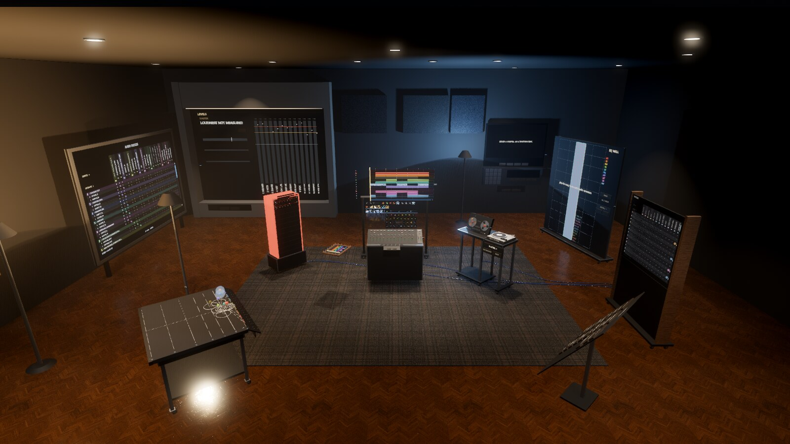</p>

The audio-devices wall, the levels wall, a rack, the arrange timeline on its stand, a console, a
tape deck and turntable, the EQ wall and the instruments board, with the stage table in front: the
room as a person standing in it sees it. Everything that stands on the floor is on wheels, to push where you want it.

<video src="https://github.com/jacob-sabella/gd-dawlings/raw/master/docs/media/studio-playing.mp4" controls muted loop playsinline width="100%"></video>

[studio-playing.mp4](https://github.com/jacob-sabella/gd-dawlings/raw/master/docs/media/studio-playing.mp4): the transport rolling, the reels turning and the meters moving.

### The timeline's deck

The arrange timeline stands in the room on its own stand; the keys under it are marks, not words
(hover one for its card). Each person's hands edit through the host, so everyone in a session
sees one project. Beyond cutting, moving and fading items, the deck also renames an item, selects
a track's items, and edits a MIDI item's notes: legato, staccato, even velocity, notes backwards,
and per-note insert, delete, pitch, length, time and velocity. A render picks its bit depth and
sample rate. Every venue has a patch wall of this machine's PipeWire graph (in the studio's side room, or
standing by the left wall elsewhere; drag jack to jack to patch), and RECOVER opens the newest autosave after a crash; hold a hand steady on it
and press to choose an older copy first.

### Venues

Only the world changes; the gear and the layout stay the same. **V** cycles them, and every
venue comes in three arrangements (a time of day, the weather, what stands round it), picked in
the stage manager.

| | |
|---|---|
| 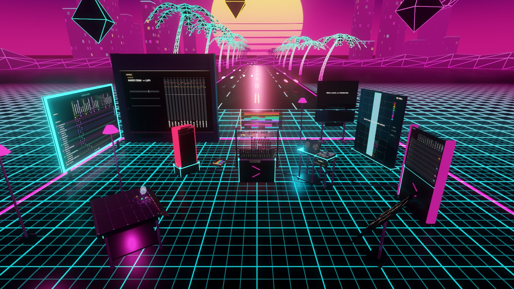 **Grid**: synthwave | 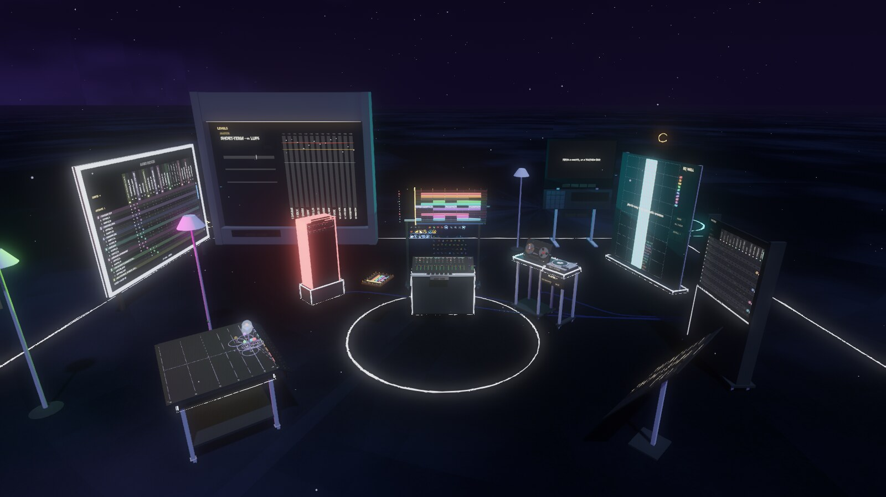 **Chalk** |
| 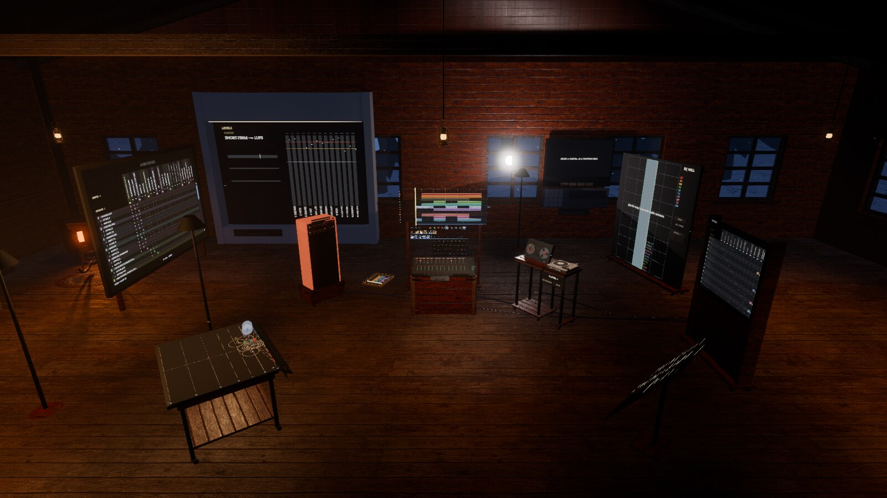 **Cabin**: a wood stove and firs | 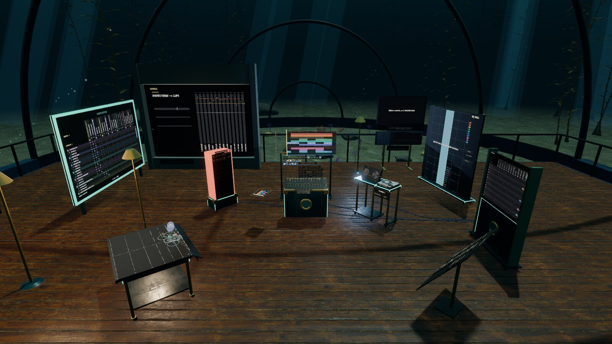 **Dome**: under the sea |
| 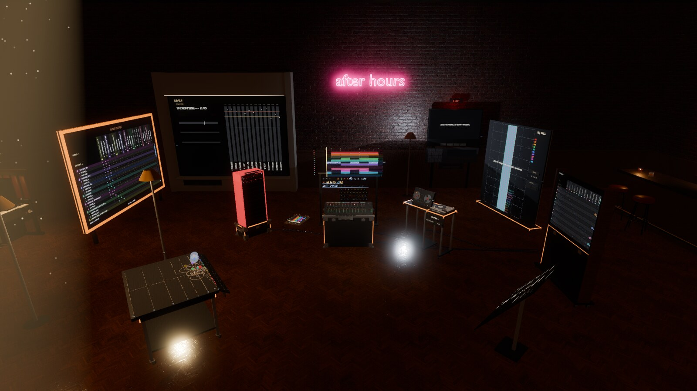 **Club**: after hours | 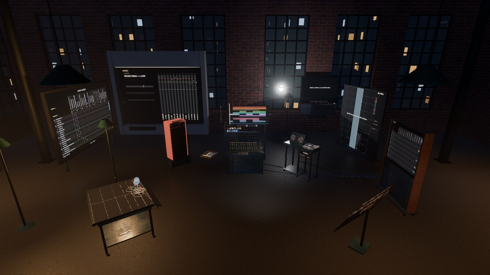 **Loft** |
| 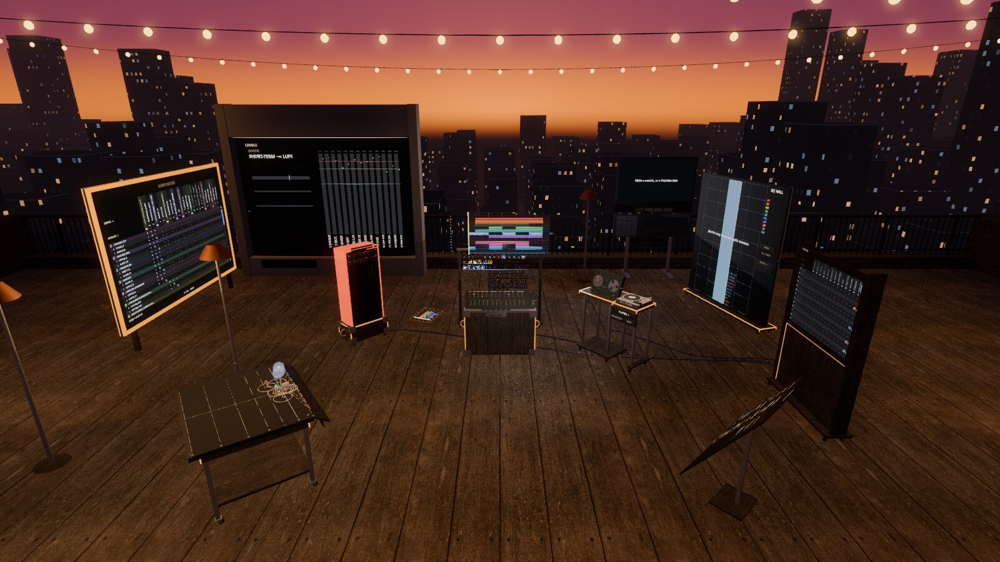 **Rooftop**: a city's water tanks | 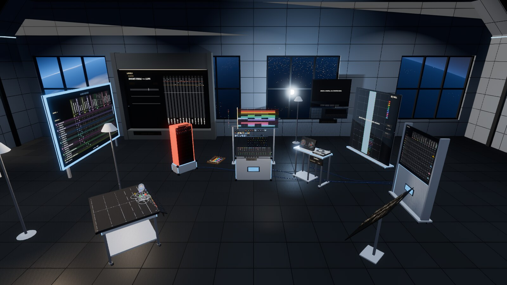 **Station**: pressure hatches |
| 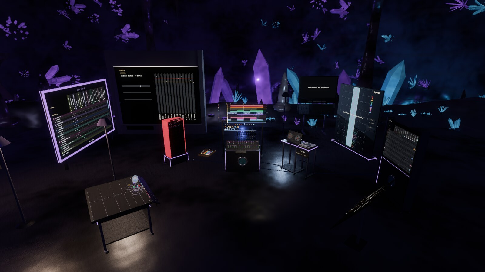 **Crystal cave**: lit from within | 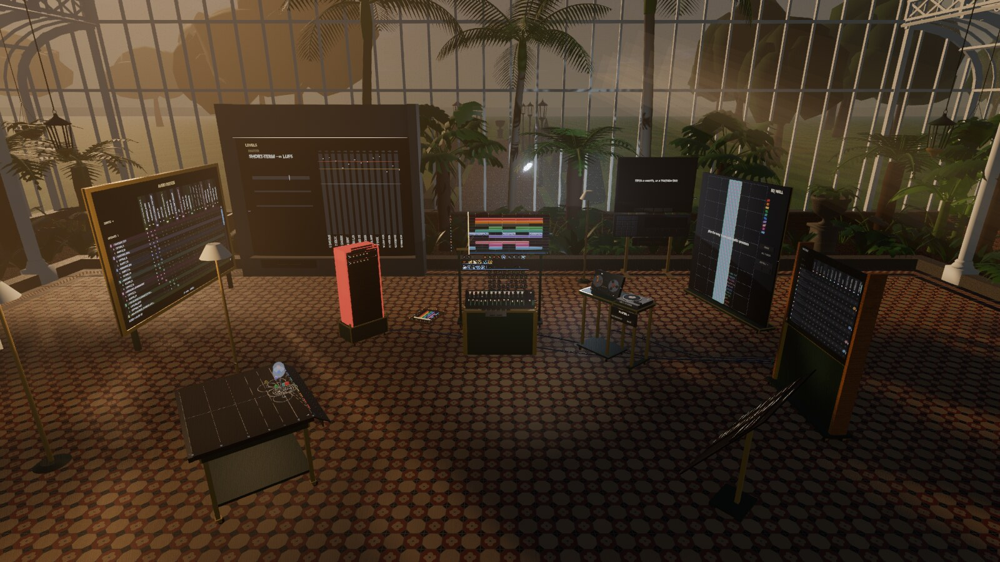 **Glasshouse**: a Victorian palm house |
| 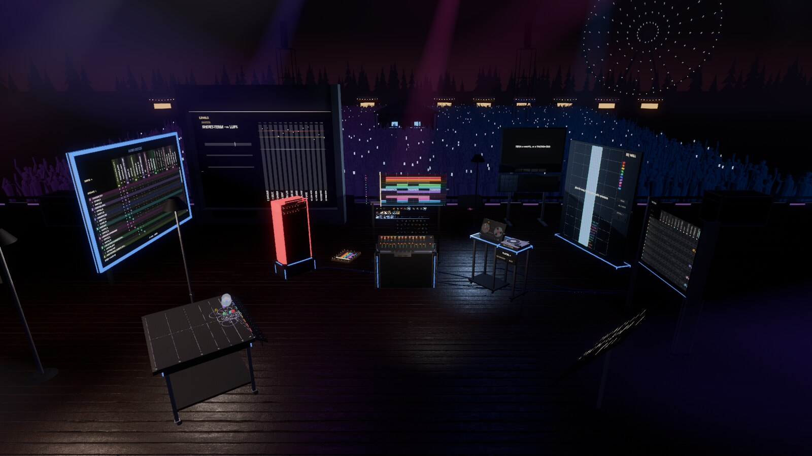 **Festival stage**: a crowd past the barricade | 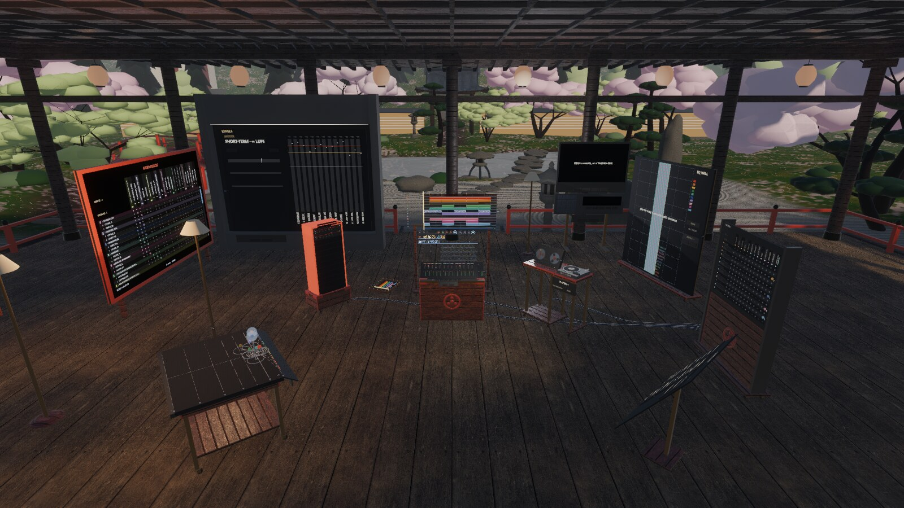 **Temple garden**: a pavilion in blossom |
| 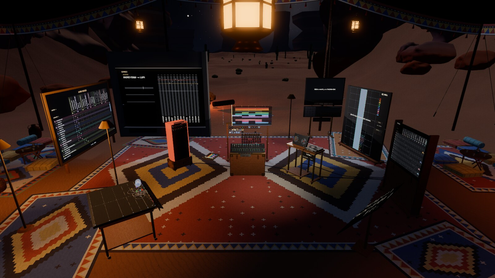 **Desert**: a tent in a slot canyon | |

<video src="https://github.com/jacob-sabella/gd-dawlings/raw/master/docs/media/grid-playing.mp4" controls muted loop playsinline width="100%"></video>

[grid-playing.mp4](https://github.com/jacob-sabella/gd-dawlings/raw/master/docs/media/grid-playing.mp4): the same room in the grid venue.

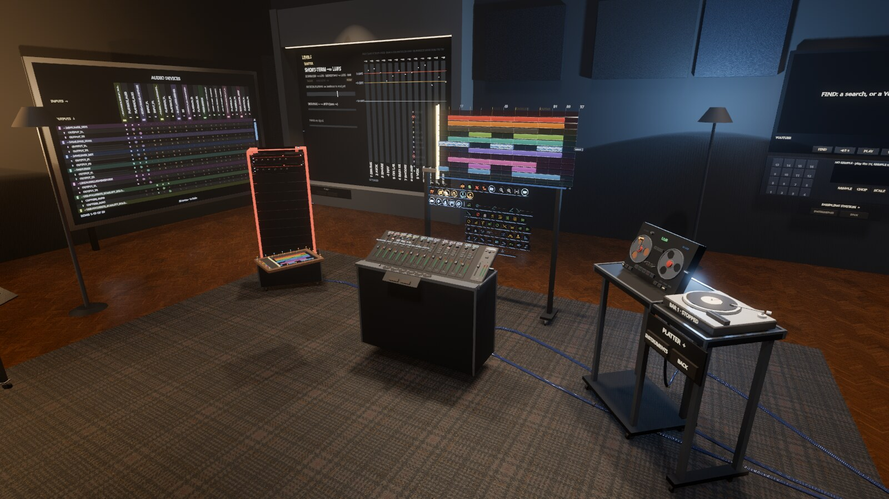

### Playing an instrument

Your keyboard plays whatever instrument plugin is on a track, with nothing to set up. On the
built-in engine the keys sound on the armed or chosen track, or else the first track that carries
an instrument; a MIDI keyboard opens by itself once there is one to play, and **P** turns the
computer keyboard into a piano (`A` to `'` from C, `Z` and `X` for the octave, Esc to stop). A
guest does the same through the host's plugin: their notes, sustain pedal, pitch wheel, mod wheel
and expression sound live on the track they play into, and are recorded as a take placed by song
position.

<p align="center">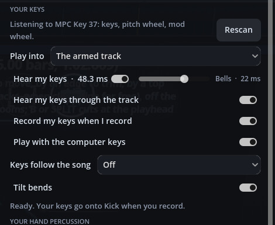</p>

**Keys follow the song** keeps a keyboard in the key: *Snap to the key* plays the nearest note of
it, *Only the key's notes* drops the rest, and *Snap to the chord* plays the nearest tone of the
chord sounding. They follow key and chord changes on the timeline.

The screenshots and clips are made by the project's own tools: `tools/shot.sh` for a still,
`tools/movie.sh` for a clip (Godot's movie writer, so the frame rate holds however slowly the
machine draws).

## Running it

```bash
godot --path .                               # offline stand-in, screen participant
godot --path . -- --built-in                 # the built-in DAW: Godot's own audio, actually playing
godot --path . -- --reaper                   # host, OSC to a local Reaper
godot --path . -- --reaper --host            # host, and open the session to peers
godot --path . -- --join 192.168.1.40 --ar   # join someone else's session, in passthrough
godot --path . -- --online                   # host, with a join code for anyone, anywhere (docs/multiplayer.md)
godot --path . -- --join-code N6UU9K         # join by that code: no address, no port forwarding
godot --path . -- --xr                       # host or join in VR, not passthrough
godot --path . -- --view 20:52               # open the timeline on seconds 20-52 (start:span)
godot --path . -- --venue grid               # stand in a given venue (studio / grid / chalk / …)
godot --path . -- --xr-sim --built-in        # a headset simulated on the desktop (add --ar for passthrough)
```

With no Reaper it comes up on a synthetic thirteen-track mix with the meters moving — silent by
default, audible with `--built-in` — so the studio can be built, lit and photographed without a
DAW in the loop. An exported build defaults to `--built-in` on its own, since whoever runs it
has no Reaper; run from the editor and you get the silent stand-in unless you ask otherwise.
Right-drag orbits, the wheel zooms, WASD walks. V cycles the venues — the studio room, a
synthwave grid, the chalk zone, and others. Only the world changes; the gear and the layout stay
the same. See `docs/venues.md`.

## Tour mode

A roguelike gig-rescue mode, one person alone or a band online. A run starts by
breaking open the road case chained shut at the back of the room — the host throws things at it
until the lid gives. Each run is a gig in trouble: a brief hands the band a looped song with
something wrong in it (a buried vocal, a muddy EQ, a dragging lane, a hard-panned guitar, a
kicked tempo, …) and a clock. Fix the flaws on the desk, play the parts the brief asks for, and
the crowd lets you move on; chaos events hit the room at random along the way, drafted
instruments and cards carry over between briefs, and reputation tracks how the run is going
overall. Busier with every friend who joins, winnable solo. See `core/tour/`, the case itself in
`core/items/tour_case.gd`, and the "Tour" section of `docs/loop_backlog.md` for what is actually
built versus still aspirational.

## Other DAWs

Reaper is one backend, not a hard-coded dependency. Nothing under `hardware/` knows any DAW's
protocol: a fader calls `DAW.set_track_volume(i, v)` on the `DAW` autoload, which holds exactly
one `DAWBackend`. `ReaperBackend` turns that into OSC; `OfflineBackend` writes it to a cache and
drives the synthetic mix; `GodotBackend` is the same stand-in made audible, on Godot's own
`AudioServer` — the engine behind it, `dawkit`, is documented below.

To add a backend, extend `core/daw/daw_backend.gd`:

- implement the command vocabulary (`set_track_volume`, `set_fx_param`, `transport_play`,
  `create_send`, and the rest of the DAW's verbs) and push incoming state through
  `MixWire.apply(state, address, args)`;
- answer `can(capability)` honestly — the patchbay greys out when `ROUTING` is false rather
  than dropping writes on the floor;
- override `taper_to_db` / `db_to_taper` if your fader law is not Reaper's, so the dB caption
  under each fader stays true.

Then hand it to `DAW.use(MyBackend.new(), true, options)` from `scenes/bootstrap.gd`. Surfaces,
replication and the session layer need no changes — guests speak verbs, not protocols, so a
guest never learns which backend the host opened.

## The built-in engine: dawkit

The built-in DAW (`--built-in`, `GodotBackend`) is built on **dawkit**, a DAW engine that runs
inside Godot — a project model, a mixer and transport on `AudioServer`, and project files in
DAWproject, the open interchange format Bitwig, Studio One and Cubase also read and write.
dawkit is developed as its own repository (`vendor/dawkit`, a git submodule), with no reference
to anything game-specific: dawlings adapts to dawkit in `core/built_in/project_bridge.gd`, never
the other way around. See `docs/architecture.md` for the split and `vendor/dawkit/README.md`
for the engine itself.

The built-in engine hosts your own **CLAP and VST3 plugins** on Linux and Windows (and LV2 on
Linux, and Windows plugins under yabridge), effects and instruments. They are found on their own the first time
it runs (and again when a plugin file changes), offered in the rack's ADD PLUGIN and FIND beside
Godot's effects, and each plugin's own window turns up on its tablet, live and clickable, without
anything opening on the desktop. An instrument plugin on a track plays its MIDI clips and your
keys. Projects save each plugin's state with them.

## Connecting a real Reaper

Two channels, because one is not enough — see `docs/transport.md` for why.

1. **OSC**, for everything that moves. Copy `reaper/Dawlings.ReaperOSC` into Reaper's
   `OSC/` folder, then add an OSC device under *Options → Preferences → Control/OSC/web*:
   device port **9000**, local listen port **8000**, pattern config **Dawlings**. Set the
   outgoing max packet size to **16384** and the wait between packets to **1** ms: at Reaper's
   defaults the meters crowd out everything else and a 40-track session takes many seconds to
   name its tracks. `tools/reaper_rig.sh up` runs a private, silent Reaper set up exactly this
   way, with a 40-track test session, for checking the link without touching your own setup.
2. **ReaScript**, for everything structural. Copy `reaper/dawlings_bridge.lua` into Reaper's
   `Scripts/` folder and run it once from the action list. Without it you get a full console,
   a working transport and live racks; what you lose is the ability to *create* routing from the
   patchbay, because OSC has no message for it.
3. **Recording from the desk.** Untick *Preferences → Recording → Prompt to save/delete/rename
   new files* (or tick its "only when stopping" options off). With it on, every take you stop
   from the desk opens a dialog in Reaper's window, and while that dialog is open Reaper ignores
   OSC entirely — the desk goes dead until someone clicks it away.

## Layout

| Path | What lives there |
|---|---|
| `core/audio/` | What the room sounds like: ports, foley, the PipeWire graph, personal mixes, the keys |
| `core/room/` | The floor plan, the session layout, and furniture on casters |
| `core/daw/` | The DAW-agnostic layer: backend contract, mix state, wire vocabulary, offline mix |
| `core/built_in/` | The built-in backend: `GodotBackend` on `AudioServer`, the demo song, the dawkit bridge |
| `core/reaper/` | The Reaper backend: OSC codec, UDP peer, the ReaScript bridge |
| `core/tour/` | Tour mode: briefs, flaws, parts, chaos events, drafts, reputation |
| `core/session/` | Who is in the room, who may write to the DAW, intent forwarding |
| `core/presentation/` | Surfaces, and the per-viewer choice of screen / room / set |
| `core/venues/` | The worlds the studio can stand in, and their shaders |
| `core/xr/` | OpenXR startup, and the two-point shared room calibration |
| `core/input/` | One grab contract for mouse, controller and hand |
| `core/items/` | Pickable and interactive room props, including the Tour road case |
| `hardware/` | Console, FX racks, tape deck, patchbay — built from live state |
| `scenes/` | Entry point and the studio itself |
| `reaper/` | The half that runs inside Reaper |
| `vendor/dawkit/` | The built-in DAW engine, as its own repository (git submodule) |
| `tools/` | `verify.sh` (tests), `shot.sh` (screenshots), `movie.sh` (clips), `tour_probe.sh` (headless Tour run), `reaper_rig.sh` (a private Reaper) |

## Verifying

```bash
tools/verify.sh                       # headless tests: OSC framing, state parsing, room maths
tools/shot.sh shots/latest.png        # render a real frame and look at it
SHOT_CAM="0,-0.28,1.35,0,0.95,0" tools/shot.sh shots/console.png
```

`verify.sh` covers the things that fail *silently* — a mispadded OSC packet is ignored rather
than rejected, a track index off by one moves a different fader, a room calibration a degree out
just puts your console slightly in the wrong place. None of them announce themselves.

It covers nothing about how any of it looks. That is what `shot.sh` is for.

## Building and releasing

Clone with `git clone --recurse-submodules` (dawkit is a submodule). CI runs the headless suite on
every branch but `master`, and the suite plus a full Linux and Windows export on every pull request
to it; a release with both zips is cut by hand when you want one. See
`RELEASING.md`.

## Reading order

1. `docs/architecture.md` — the three-way split, the DAW-as-backend seam, and the dawkit split
2. `docs/transport.md` — the Reaper link, what each channel can and cannot carry
3. `docs/colocation.md` — how several headsets agree where the console is
4. `docs/loop_backlog.md` — what is scaffolded versus what is finished, Tour included

## Vibe Coded

This entire project was vibe coded with [Claude Code](https://claude.ai/code). The game, the
hardware, the venues, the session and networking layers, the timeline, the tooling and the tests,
and its engine, dawkit — all of it. No hand-written code.

## Licence

MIT. See LICENSE. Its engine, dawkit (`vendor/dawkit`), is MIT too, with its own LICENSE and THIRD_PARTY_NOTICES.md.
