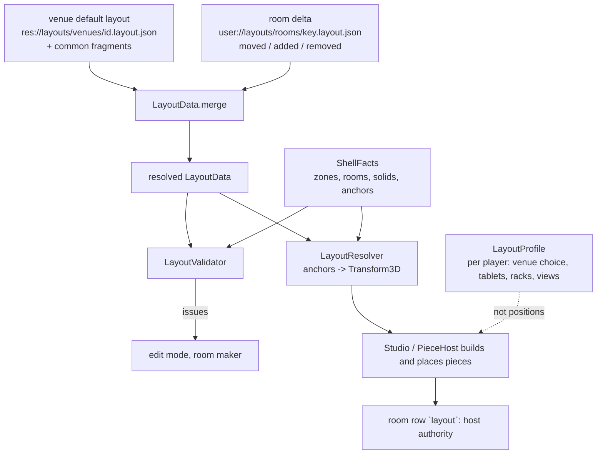

# Layouts: rooms as data

Status: **DESIGN, draft for owner review** (2026-11-07). Nothing here is built. It is queue item 2 of
`docs/refactor_loop.md` and feeds items 6-8. "Today" claims cite `docs/refactor_state_map.md` (SM) or
a file:line. Companion: `docs/mods.md` (manifests, registry; a piece is delivered as a mod entry).

## 1. Terms

| Term | Meaning |
|---|---|
| **Room** | What a player stands in: a shell plus a layout. The 14 venues, each in 3 arrangements, and the roulette room are the rooms that exist today (`Venue.IDS`, `venue.gd:21`; `Venue.VARIANTS`, `:31`). |
| **Shell** | The walls, ground, sky and fixed solids. Code today (`XVenue._ready`, SM 2.2). It reports its geometry as **shell facts** (3). |
| **Layout** | A JSON file: which shell, which pieces stand where, how they are grouped and wired, what is attached. |
| **Arrangement** | One of a venue's variants (Dusk / Golden hour / Night). In a layout: an entry in `variants` that overrides part of it. |
| **Piece** | Anything that stands in a room and is placed by the layout: a station, a trolley, a shelf, the venue's instrument, the modular annex. Defined once in a **piece definition** (4), placed many times. |
| **Single item** | A piece that sits in any room: small, a footprint on the floor or a mount on a wall, a zone or a shelf. Cassette rack, sampler, hoop, tablet. |
| **Room-scale mod** | A piece that needs a room of its own: it claims real estate beyond the live room and a doorway. Today only the modular room (`ModularAnnex`). |
| **Anchor** | A named point or line the shell provides: `wall.left`, `control_rear`, `zone.synth`, `annex_edge`. Placements are written relative to anchors so they follow the room's width. |
| **Slot** | A place inside a piece that holds smaller things (the prop shelf's item spots, `Venue.item_spots`, `venue.gd:412`). Slots belong to the piece definition, not the layout. |
| **Wiring** | Declared relations between pieces: what feeds, rides on or opens onto what. Today these are fields of `Studio` and `if` branches. |
| **Zone** | One of the five activity boxes (bricks, matrix, drums, vocals, synth, `Venue.ZONES`, `venue.gd:65`). |

Goals and tests this must keep (SM 2.6): every piece clear of every other (`ROOM_CLEAR` 0.6 m,
`run_tests.gd:26733`) and of the footprint and solids, every station reachable from the mix position,
in all 42 venue/arrangement combinations.

A correction to the SM for this design: SM 2.2 counts "11 of 14 venue files override `*_spot`".
Comparing function names with `venue.gd`, those overrides are scenery (`pole_spots`, `chair_spots`).
The overrides that matter for placement are few: every venue overrides `rooms()` and `zone_solids()`;
`studio_venue.gd` also `zones()` (`:154`) and `default_prop_shelf_spot()` (`:185`); `greenhouse_venue.gd`
`annex_edge()` (`:274`); `roulette_room.gd` `live_room_half`, `solids`, `zones`, `rig_roulette_spot`. That
makes the conversion much smaller than SM 5.2 point 8 feared.

## 2. Architecture



Three layers of position, top wins:

1. **Venue default** (shipped, read-only): `res://layouts/venues/<id>.layout.json`, which `extends` shared
   fragments in `res://layouts/common/` (control room, standard live room), so the 14 files hold only what differs.
2. **Room delta** (the host's, shared): `{base, variant, moved, added, removed}` in
   `user://layouts/rooms/<key>.layout.json`. "Reset to default" is deleting entries from it.
3. **Per player** (`LayoutProfile`, `core/presentation/layout_profile.gd`): venue choice, tablets and
   track racks, view modes. **Not piece positions** any more (6).

## 3. Shell facts: validating without building a room

The placement tests build a full `Studio` and a venue's geometry for each of 42 combinations (SM 5.2
point 12). Validators must not. `ShellFacts` is the pure data a shell reports:

```
class_name ShellFacts extends RefCounted
  var room_width: float            # Studio.room_width (11.2 base), grows in 0.8 m steps
  var footprint: Rect2             # the working footprint (control room)
  var rooms: Array[Rect2]          # Venue.rooms(): walkable floor
  var solids: Array[Dictionary]    # {c, h, a, top}: Venue.solids() + zone_solids() + instrument/weather solids
  var zones: Dictionary            # id -> AABB (Venue.zones())
  var live_room_half: float        # Venue.live_room_half()
  var annex_edge: float            # Venue.annex_edge()
  var has_walls: bool
  func anchor(name: StringName) -> Variant   # Vector2/float, null if the shell has none
  static func of(venue: Venue) -> ShellFacts  # reads an un-readied Venue (no children)
```

`Venue.make(id, v)` followed by `facts()` must not need `_ready` (it must not read child nodes). Step 2 proves
this by comparing `ShellFacts` from an un-readied venue with one from a built venue for all 42 combinations
(and the roulette room). Where a venue's `solids()` reads nodes today, the solid becomes a constant.

Anchors the shell provides (names are the contract): `wall.left`, `wall.right` (x of the live room's
side walls, +-`live_room_half`), `control_wall.left|right` (+-`room_width/2`), `control_rear` (z =
`Studio.ROOM_BACK` = 4.0), `live_back` (`LIVE_ROOM_BACK` 12.4), `mix` (`Studio.MIX_POSITION_Z` 0.66),
`zone.<id>` (centre; `.cx`, `.cz`, `.min`, `.max`), `annex_edge`.

## 4. Pieces

### 4.1 Piece definition

A piece definition is a mod entry of kind `piece` (`docs/mods.md` 3.2), so a mod can add one. The built-in
ones live in `res://mods/builtin/pieces/`. It replaces a `Stations.ALL` row (24 rows with strings naming
`Venue` methods, `stations.gd`), a `LIVE_TROLLEYS` entry (`studio.gd:1790`), a `Venue.WHEELED` id and a
branch in `_carry_live` (`studio.gd:1940`).

| Field | R/O | Meaning |
|---|---|---|
| `id`, `title` | R | e.g. `cassette_rack`, "CASSETTE RACK" |
| `class` | R | `single` or `room_scale` |
| `builder` | R | a name in the code-side `PieceBuilders` table (one list) that makes and moves the node: `CassetteRack`, `Sampler`, `ModularAnnex` |
| `mount` | R | `floor` \| `wall` \| `zone` \| `surface` \| `venue` \| `shelf` |
| `mobility` | O | `wheeled` or `fixed` (default `fixed`); the layout may override per placement |
| `footprint` | R for floor | `{"half":[x,z],"offset":[x,z]}` and `top`: the same numbers `Stations` `foot`/`foot_z`/`top` and the trolley use, once |
| `trolley` | O | `{"weight":9.0,"grips":[...]}` (`LIVE_TROLLEYS`) |
| `needs` | O | zone ids it cannot stand without (`["synth"]` for the sampler, `default_sampler_spot` returns null without one, `venue.gd:658`) |
| `station` | O | `area`, `air`, `seat`, `reach`, `at`, `frame`, `desk`/`hands` help: the rest of the `Stations` row |
| `slots` | O | named places inside it that hold items |
| `followers` | O | what rides with it when it moves (the shelf's toys, the rack's cassettes: today `_carry_live`) |
| `claims` | R for `room_scale` | see 4.3 |
| `limit` | O | max copies per room (1 for `modular_annex`) |

### 4.2 Catalogue of today's things

| Piece | Class | Mount | Mobility | Today |
|---|---|---|---|---|
| `cassette_rack`, `sampler`, `tour_case`, `prop_shelf`, `hoop` | single | floor | wheeled | `Venue.WHEELED` (`venue.gd:889`) |
| `wheel`, `sections`, `drums`, `looper`, `lyrics` | single | zone | fixed | `Stations` `zone` field |
| `stage_table`, `eq_wall`, `levels`, `tv`, `platter`, console, rack trolley, patch stand | single | floor / surface / cart | wheeled | `Studio._build_furniture` (`studio.gd:1229-1770`) + `SessionLayout`; part of the control-room fragment |
| venue instrument, weather switch | single | venue | fixed | `Stations` `mounted`, `weather`; the shell supplies the spot |
| plugin tablets, track racks | single | floor | wheeled, player-owned | `studio.gd:2056-2438` |
| toys, tablet, instruments on the prop shelf | item | shelf slot | picked up | `ItemRoom`, `item_spots` |
| `modular_annex` | **room_scale** | beyond wall | fixed | `ModularAnnex`, built onto every venue (`modular_annex.gd`, SM 1.3) |

Held stations (fingertips, clap, lean, jacks, `Stations` `HELD_AREA`) are not pieces: they have no place.
Items are not placed by a layout; their shelf is.

### 4.3 Single item or room-scale mod, and how it claims space

`class` is in the definition, never in the layout, so a layout cannot make a big thing small. A
single item has a floor footprint (or a mount) inside the live room and is validated as in 6.
A room-scale piece declares what it takes:

```
"claims": {
  "site":  {"beyond": "wall.right", "span_z": [6.0, 13.0], "depth": 8.0, "height": 4.4},
  "door":  {"z": 9.0, "width": 1.9, "height": 2.35},
  "clear_in_front_of_door": 1.2
}
```

(these are the `ModularAnnex` constants `Z_FROM`/`Z_TO`/`DEEP`/`HEIGHT`/`DOOR_Z`/`DOOR_WIDE`/`DOOR_HIGH`,
`modular_annex.gd`). The validator checks that no other room-scale claim overlaps the site, that the wall
at the door can be cut (a shell fact `can_cut(wall, z, width)`, today `cut_the_wall`, `:648`), and that
nothing stands in the doorway's walkway. The piece's builder adds its own `floors()` to the walkable
rooms (as `Venue.walk_rooms` does, `venue.gd:596`) and its `solids()`. The annex then becomes one
piece the layout lists or omits, instead of `Studio._stand_the_annex` for every venue
(`studio.gd:4739`); the roulette room omits it (today `modular_spot` returns null there, `venue.gd:588`).

## 5. The layout file

### 5.1 Schema (abridged)

```json
{
  "$schema": "https://json-schema.org/draft/2020-12/schema",
  "title": "dawlings layout, version 1",
  "type": "object",
  "required": ["format", "version", "id", "title"],
  "properties": {
    "format": {"const": "dawlings.layout"},
    "version": {"const": 1},
    "id": {"type": "string", "pattern": "^[a-z][a-z0-9_-]{0,39}$"},
    "title": {"type": "string"},
    "extends": {"type": "array", "items": {"type": "string"}},
    "order": {"type": "integer", "description": "position in the venue cycle (Venue.IDS order)"},
    "shell": {"type": "object", "properties": {"builder": {"type": "string"}, "kit": {"type": "string"}, "size": {"type": "string"}}},
    "mood": {"type": "object", "properties": {"base": {"type": "string"}, "hit": {"type": "string"}, "glow": {"type": "number"}}},
    "zones": {"type": "object", "additionalProperties": {"type": "object", "required": ["min", "size"], "properties": {"min": {"type": "array"}, "size": {"type": "array"}, "grow": {"enum": ["outward", "none"]}}}},
    "pieces": {"type": "array", "items": {"$ref": "#/$defs/placement"}},
    "groups": {"type": "array", "items": {"type": "object", "required": ["id", "title", "members"]}},
    "wiring": {"type": "array", "items": {"type": "object", "required": ["kind", "from", "to"], "properties": {"kind": {"enum": ["feeds", "rides", "loom", "opens_onto"]}}}},
    "variants": {"type": "array", "minItems": 1, "items": {"type": "object", "required": ["title"]}}
  },
  "$defs": {
    "placement": {"type": "object", "required": ["id", "piece"], "properties": {"id": {"type": "string"}, "piece": {"type": "string"}, "at": {"type": "object"}, "mobility": {"enum": ["wheeled", "fixed"]}, "enabled": {"type": "boolean", "default": true}}}
  }
}
```

`at` is `{"anchor": {"x": "<name>", "z": "<name>"}, "pos": [dx, dz], "yaw": radians}`: the position is
the anchors' values plus `pos` (an absent anchor means the floor's origin), `yaw` is about +Y as in
`Transform3D(Basis(Vector3.UP, yaw), ...)`. `{"frame": "authored:<piece id>", "local": [x, z], "yaw": r}`
places a piece in another's authored frame (not its pushed one; this is what `default_cassette_rack_spot`
does, `venue.gd:641`). A zone-mounted piece has no `at`: its definition's zone-relative rule applies.

`variants[i]` may carry any of `zones`, `pieces` (merged by `id`; `"enabled": false` removes), `groups`,
`wiring`. Variant 0 is the base. Merge rule: objects merge by key, arrays of `id`-bearing objects merge by
`id`, other arrays replace.

### 5.2 Worked example: the rooftop, today's numbers

The rooftop (`rooftop_venue.gd`, 858 lines) overrides none of the placement functions; it stands on the base
class (SM 2.2), at base width (`room_width` 11.2, so `live_room_half` 8.8 and zone growth 0). The five
wheeled pieces' defaults, from `venue.gd:399-540,641-672`:

| Piece | Formula in code | Resolves to (x, z, yaw) |
|---|---|---|
| `prop_shelf` | x = -half + 0.08 + `SHELF.z`/2 (0.21), z = `ROOM_BACK` + `TOYS_IN` 1.0, yaw pi/2 | -8.51, 5.0, 1.5708 |
| `cassette_rack` | shelf frame, local (-(0.475 + `RACK_GAP` 0.65 + `FOOT.x` 0.22), -0.21 + `FOOT.y` 0.1) | -8.62, 6.345, 1.5708 |
| `hoop` | x = wall (-8.8) + `TOYS_ACROSS` 3.5 + 0.1, z = shelf z + `HOOP_ALONG` 0.4, yaw -pi/2 | -5.2, 5.4, -1.5708 |
| `tour_case` | x = wall + 3.5, z = shelf z + `TOUR_CASE_ALONG` 2.0, yaw -pi/2 | -5.3, 7.0, -1.5708 |
| `sampler` | synth zone centre (8.3, 11.0): x - `SYNTH_MIDDLE` 1.7, z + `SAMPLER_RING` 1.1, yaw pi | 6.6, 12.1, 3.1416 |

Shared fragment, `res://layouts/common/live_room.layout.json`:

```json
{
  "format": "dawlings.layout",
  "version": 1,
  "id": "common.live_room",
  "title": "Standard live room",
  "pieces": [
    {"id": "prop_shelf", "piece": "prop_shelf", "mobility": "wheeled", "at": {"anchor": {"x": "wall.left", "z": "control_rear"}, "pos": [0.29, 1.0], "yaw": 1.5708}},
    {"id": "cassette_rack", "piece": "cassette_rack", "mobility": "wheeled", "at": {"frame": "authored:prop_shelf", "local": [-1.345, -0.11], "yaw": 0.0}},
    {"id": "hoop", "piece": "hoop", "mobility": "wheeled", "at": {"anchor": {"x": "wall.left", "z": "control_rear"}, "pos": [3.6, 1.4], "yaw": -1.5708}},
    {"id": "tour_case", "piece": "tour_case", "mobility": "wheeled", "at": {"anchor": {"x": "wall.left", "z": "control_rear"}, "pos": [3.5, 3.0], "yaw": -1.5708}},
    {"id": "sampler", "piece": "sampler", "mobility": "wheeled", "at": {"anchor": {"x": "zone.synth.cx", "z": "zone.synth.cz"}, "pos": [-1.7, 1.1], "yaw": 3.1416}},
    {"id": "wheel", "piece": "wheel"},
    {"id": "sections", "piece": "sections"},
    {"id": "drums", "piece": "drums"},
    {"id": "looper", "piece": "looper"},
    {"id": "lyrics", "piece": "lyrics"}
  ],
  "groups": [
    {"id": "rhythm", "title": "RHYTHM", "colour": "#FF9E6B", "members": ["drums", "looper"]},
    {"id": "harmony", "title": "HARMONY", "colour": "#9EDBFF", "lift": -0.4, "members": ["wheel", "sections"]},
    {"id": "synth", "title": "SYNTH & SOUND DESIGN", "colour": "#C7A8FF", "lift": 0.25, "members": ["sampler"]},
    {"id": "vocals", "title": "VOCALS", "colour": "#FFB3D1", "members": ["lyrics"]},
    {"id": "tape", "title": "TAPE & TOYS", "colour": "#B3FFB8", "members": ["cassette_rack", "prop_shelf", "tour_case", "hoop"]}
  ],
  "wiring": [{"kind": "feeds", "from": "sampler", "to": "cassette_rack"}]
}
```

The groups are `Neighbourhoods.ALL` (`neighbourhoods.gd:30`; `mixing` goes in the control-room fragment).
The `feeds` wire is "one sample, a WAV and a cassette on the rack" (`stations.gd`, sampler row).

The venue file, `res://layouts/venues/rooftop.layout.json`:

```json
{
  "format": "dawlings.layout",
  "version": 1,
  "id": "rooftop",
  "title": "Rooftop",
  "order": 6,
  "extends": ["common.control_room", "common.live_room"],
  "shell": {"builder": "RooftopVenue"},
  "mood": {"base": "#7399FF", "hit": "#FFB3E6", "glow": 0.75},
  "zones": {
    "vocals": {"min": [-8.7, 0.0, 9.2], "size": [3.4, 2.6, 3.1], "grow": "outward"},
    "drums": {"min": [-3.4, 0.0, 4.8], "size": [2.6, 2.8, 2.6], "grow": "outward"},
    "matrix": {"min": [0.0, 0.0, 8.6], "size": [3.4, 3.4, 3.4], "grow": "outward"},
    "bricks": {"min": [6.8, 0.0, 4.6], "size": [1.9, 1.3, 2.9], "grow": "outward"},
    "synth": {"min": [7.9, 0.0, 10.0], "size": [0.8, 2.0, 2.0], "grow": "outward"}
  },
  "pieces": [
    {"id": "modular_annex", "piece": "modular_annex", "at": {"anchor": {"x": "annex_edge"}, "pos": [0.0, 0.0], "yaw": 0.0}}
  ],
  "wiring": [{"kind": "opens_onto", "from": "modular_annex", "to": "live_room"}],
  "variants": [{"title": "Dusk"}, {"title": "Golden hour"}, {"title": "Night"}]
}
```

The annex resolves, at base width and the rooftop's `annex_edge` = `live_room_half` = 8.8
(`venue.gd:1275`): near wall centre x = 8.8 + `GAP` 0.63 + `WALL`/2 0.1 = 9.53; inside x 9.63 to 17.63,
z 6.0 to 13.0; doorway at z 9.0, 1.9 wide, 2.35 high; the rack at (17.49, 1.0, 9.2), yaw -pi/2, scale 1.2
(`ModularAnnex.rack_spot`, `modular_annex.gd:87`). The mood is `RackMood.MOODS[&"rooftop"]`
(`rack_mood.gd:15`: 0.45,0.6,1.0 / 1.0,0.7,0.9 / 0.75).

A variant that does change placement shows the idea. `studio` arrangement 1 ("Live room beside") overrides
`default_prop_shelf_spot` (`studio_venue.gd:185`) to x = `-room_width`/2 + 0.05 + 0.08 + 0.21, z = `ROOM_BACK` +
`BESIDE_TOYS_IN` 2.4, and `zones()` to `SIDE_ZONES` (`:51`). As data:

```json
{
  "title": "Live room beside",
  "pieces": [
    {"id": "prop_shelf", "piece": "prop_shelf", "at": {"anchor": {"x": "control_wall.left", "z": "control_rear"}, "pos": [0.34, 2.4], "yaw": 1.5708}}
  ],
  "zones": {
    "drums": {"min": [-9.6, 0.0, -3.4], "size": [2.6, 2.8, 2.6], "grow": "none"},
    "matrix": {"min": [-11.0, 0.0, 0.45], "size": [3.4, 3.4, 3.4], "grow": "none"},
    "vocals": {"min": [-14.5, 0.0, -3.9], "size": [3.4, 2.6, 3.1], "grow": "none"}
  }
}
```

(The real code subtracts `_grow()` from the side-room boxes, `studio_venue.gd:159`: a `grow` value `"inward"` is
added for it.) Studio's `rooms()` for this arrangement (`:171`) is shell facts and stays code.

### 5.3 The 14 venues, the roulette room and their 3 arrangements

* 14 files `res://layouts/venues/<id>.layout.json`, each with `variants` of 3 titles taken from `Venue.VARIANTS`
  (`venue.gd:31`). Only the studio's arrangements change placements or zones; in the other 13 a variant is a
  title and the shell builder reads the index.
* `roulette.layout.json`: one variant, `"order": null` (not cycled), `zones: {}`, no `modular_annex`, one piece
  `rig_roulette` at x -2.2, z -1.5, yaw 0.5, y 1.45 (`roulette_room.gd`). Its `live_room_half` and `solids`
  are shell facts. The pieces that need no zone (`prop_shelf`, `hoop`, `tour_case`, `cassette_rack`) stand as in the base
  class, inside the room's own half-width (`:39`); `sampler` has `needs: ["synth"]` and is skipped by the
  rule "a piece whose `needs` zone is missing is skipped, not an error".
* 42 combinations remain 14 x 3; the validator test (8) loops the files, not the classes.
* `Venue.IDS`, `Venue.make_title`, `Venue.variant_titles`, `RackMood.MOODS`, `VENUE_SETS` (tests) are
  derived by scanning the layout directory, ordered by `order`. `Venue.make` becomes a lookup of
  `shell.builder` in one `ShellBuilders` table (the one list that must stay while shells are code).

## 6. Validators

`LayoutValidator` is pure: layout + `ShellFacts` in, issues out. No `Studio`, no nodes.

```
class_name LayoutIssue extends RefCounted
  var code: StringName     # see below
  var severity: int        # ERROR | WARNING
  var piece: StringName    # offender
  var other: StringName    # what it clashes with, if any
  var at: Vector2          # where, for a marker in edit mode
  var message: String      # player-facing sentence
  var fix: Dictionary      # optional {"pos": [x,z]} nearest clear spot
class_name LayoutValidator
  static func validate(layout: LayoutData, facts: ShellFacts, opts := {}) -> Array[LayoutIssue]
  static func validate_piece(layout: LayoutData, id: StringName, facts: ShellFacts) -> Array[LayoutIssue]
  static func nearest_clear(layout: LayoutData, id: StringName, wanted: Vector2, facts: ShellFacts) -> Variant
```

`validate_piece` is the interactive one (a ghost while dragging). Checks and the test each replaces:

| Code | Rule | Replaces |
|---|---|---|
| `schema`, `duplicate_id`, `unknown_piece`, `unknown_anchor`, `cycle` | structure, `frame` cycles | new |
| `off_floor` | footprint inside `rooms` (polygon test) | `_test_every_venue_stands_every_station_clear` (`:26660`) "on the floor" |
| `hits_solid` | footprint clear of `solids`, zone boxes (`zones` minus the zone it is mounted in) and the control-room footprint | same test |
| `too_close` | polygon gap between footprints at least `ROOM_CLEAR` (0.6 m) | `_..._keeps_its_pieces_apart...` (`:26741`) |
| `unreachable` | every station with `station.seat` is reached from the mix position by a clearance-0.3 grid walk over `rooms` minus `solids` and footprints | same test; the walker query is extracted from the test into `LayoutReach` |
| `no_seat` | the seat point (`station.seat`) is on the floor and faces the piece | same test, "a seat to fit at, facing it" |
| `group_spread` | group members within `Neighbourhoods.RADIUS` (3.4 m) of their middle | the six `_test_the_*_neighbourhood_*` tests (`:27062`) |
| `needs_missing` | a piece whose `needs` zone is absent is **skipped** (no error) | `null` = "no room here" in `Stations` |
| `door_blocked`, `site_taken`, `wall_uncuttable` | room-scale claims (4.3) | `_test_every_venue_has_a_clear_door_to_the_roulette_room` is separate and stays |
| `unavailable_mod` | a piece or mod it needs is missing | warning, the piece stays (as plates in `docs/mods.md`) |
| `over_limit` | more than 64 pieces, `limit` exceeded | new |

The 42-combination guarantee becomes `_test_every_layout_is_valid` (loops files and variants, runs
`validate`, no Studio, expected to be fast). The old Studio tests stay during migration, run beside the new
one, and are removed only when step 6 proves them equal.

## 7. Editing, saving, sharing

**Edit mode.** A mode of the station board (headset) and a key on the desktop (binding chosen at build;
it must not clash with `Stations` keys). In it each movable piece shows a handle and its footprint. Four
operations, all one verb as `ask_rack` is for the rack (SM 1.6):

```
ask_layout(op, args):  move(id, x, z)  rotate(id, yaw)  add(piece, x, z, yaw)  remove(id)  reset(id | "all")
```

Authority applies the op to the room delta, runs `validate_piece`, and either commits (a new `rev`,
`_publish_room_soon`) or answers with the issues; the ghost goes red. A guest sends the op through
`Session.ask_room(&"layout", [op, args])` (argument types validated at `session.gd:1686`) and predicts it
locally as `_predict` does now. Fixed pieces can be moved in edit mode only if their placement is
overridable (`mobility` is a trolley property; a zone-mounted piece moves with its zone, not alone).
Pushing a wheeled piece in normal play (the Trolley) is the same `move` op at the end of the push, as
today's `_on_trolley_settled` (`studio.gd:3285`).

**Reset.** `reset(id)` removes that piece from `moved`/`added`/`removed`; `reset("all")` deletes the delta.
A pushed position equal to the default is not stored (today's `_where_the_venue_stands_it`,
`studio.gd:3269`) so a wider room re-stands it.

**Reconciling with today.**

| Today | New |
|---|---|
| `LayoutProfile` key `floor/<id>`, per player (`layout_profile.gd`) | gone as a position store. First run: each stored `floor/*` that is not an old default (`was_an_old_default`, `studio.gd:3249`) becomes a `moved` entry in the delta of the room the player is in; then the keys are removed |
| Room row `floor {id: [x, z, yaw]}` (`studio.gd:2446`) | replaced by `layout {base, variant, rev, moved, added, removed}` |
| Guest's wheel as prediction, host confirms (`move_piece`) | the same, as the `move` op |
| Room row `placed`, `tablets`, `track_racks` | unchanged (surface homes and player-owned pieces) |
| `OLD_FLOOR_DEFAULTS`, `OLD_FIT_LINES`, `OLD_EQ_WALL` (`studio.gd:3219-3240`) | used once by the import above, then deleted (open question 5) |

**Persistence unit.** A room is `(base venue or kit, variant)` plus its delta, keyed `<venue>.<variant>` for the
built-in rooms and `<slug>` for made ones. Positions are therefore **per room**, not global: today a pushed
hoop keeps its x,z in every venue (re-spotted against each venue's solids on arrival, `_wheel_in_live_pieces`
`studio.gd:1902`). Open question 2.

**Sharing and the guest.** The host's delta rides in the room row; the guest builds the same room from the
shared `base`/`variant` and the delta, so no layout file is transferred. A guest sees everything. A guest
may push wheeled pieces, as now, confirmed by the host; **add, remove, rotate and reset are host-only**
(host authority). Whether a host may open edit mode to guests is open question 3. A guest who lacks a piece's
mod sees its unavailable plate in place (`docs/mods.md` 6.3); the footprint is declared in the row's `added`
entry (`footprint` copied from the definition at add time), so the guest's validator and collisions still work.

## 8. The new-room maker

A panel in the stage manager (the first row picks a venue today, `docs/venues.md`). The player chooses:

1. **Name** (becomes the slug).
2. **Shell**: a kit and a size. First kit: `box`, one size, `standard` (the live room every venue has:
   8.4 x 17.6 m, `venue.gd:81-82` and the `ZONES` comment), walls and floor materials chosen by style. More
   sizes are an open question (4).
3. **Style**: a preset (`warm`, `cool`, `neon`, `daylight`, `dark`) setting the environment, lamps, gear
   style and the rack mood colours (the `RackMood` triple), or "like venue X" which copies that venue's `dress()`
   and mood.
4. **Pieces**: a checklist grouped by neighbourhood from the catalogue (4.2). The control-room fragment is
   locked on. Defaults are the standard live room (`common.live_room`). Each tick places the piece by its default
   anchor; the player then moves it in edit mode.

Output: `user://layouts/rooms/<slug>.layout.json` with `shell: {"kit":"box","size":"standard","style":"warm"}`
and `extends: ["common.control_room", ...]`. The maker runs `validate` live; a piece that cannot be placed
shows the issue next to its tick. **Errors shown to the player** are `LayoutIssue.message`: "The hoop is 0.4 m
from the shelf; they need 0.6 m." with the offending pair highlighted in the room and a "move to nearest clear
spot" button using `fix`. Errors block saving; warnings (`unavailable_mod`, `group_spread`) do not.

## 9. Storage

| What | Where | Naming |
|---|---|---|
| Shipped venues, fragments | `res://layouts/venues/`, `res://layouts/common/` | `<id>.layout.json` |
| Made rooms and deltas | `DataHome.dir("layouts")` + `/rooms/` = `user://layouts/rooms/` | `<slug>.layout.json`; slug `[a-z0-9-]{1,40}`, a clash gets `-2`; built-in rooms use `<venue>.<variant>.layout.json` |
| Safety | atomic write (temp + rename), one `.bak` of the last good file | |
| Piece definitions | `res://mods/builtin/pieces/`, user pieces in `user://mods/` | by the mod system |

`DataHome` today only migrates the old `reaper-3d` folder (`core/data_home.gd`) and offers no `dir()`;
the helper is added by the mod work (`docs/mods.md` 5). A bad file is not fatal: it is renamed `.bad`, the
room falls back to its default, and the player sees a toast.

## 10. How the parallel registries collapse

| Today | Collapses into |
|---|---|
| `Stations.ALL` rows and the `spot: &"name"` strings (`stations.gd`) | piece definitions (`station` block); placement is the layout's `at`, no method names |
| `Venue.WHEELED`, `Venue.default_spot` (`venue.gd:889,895`) | `mobility: wheeled` + the placement |
| `Venue.default_*_spot` (5) and the ~60 `*_spot()` | `LayoutResolver.transform(layout, id, facts)`; the `*_spot()` methods become one generic `Venue.spot(id)` |
| `Studio.LIVE_TROLLEYS` (`studio.gd:1790`) | `trolley` and `footprint` in the definition |
| `Studio._carry_live` `match` | `followers` + the builder's `moved()` |
| `Neighbourhoods.ALL` (`neighbourhoods.gd:30`) | `groups` |
| `Venue.IDS`, `make`, `VARIANTS`, `make_title`, `RackMood.MOODS`, tests' `VENUE_SETS` | the layout directory (`id`, `title`, `order`, `variants`, `mood`) + one `ShellBuilders` table |
| venue overrides `zones()`, `default_prop_shelf_spot()`, `annex_edge()`, `rig_roulette_spot()` | variant `zones`/`pieces` entries; `annex_edge` a shell fact |
| `Studio._stand_the_*` (11 functions, `studio.gd:619-1070`) | one `PieceHost` loop over resolved pieces |

## 11. Migration plan

Each step keeps the suite green; none changes behaviour until step 5. Steps 1-7 are queue item 6, 8-10
item 7, 11-12 item 8.

1. **`LayoutData` parser and merge** (`extends`, variants), `layouts/layout.schema.json`, fixtures. Unused.
2. **`ShellFacts`** and the un-readied-venue equivalence test over 42 + 1.
3. **`LayoutResolver`** and `common.live_room` for the five wheeled pieces; a test that resolved transforms
   equal `Venue.default_spot` for every combination (1e-4). Venues untouched.
4. **`LayoutValidator`** and `_test_every_layout_is_valid`, with seeded violations. Old tests unchanged.
5. **Switch the five.** `default_*_spot` bodies, `WHEELED`, `LIVE_TROLLEYS`, the five `_carry_live` arms read
   the layout; studio's shelf override becomes its variant entry. Old placement tests must pass untouched.
6. **The rest of `Stations.ALL`**, zone-mounted pieces, the control-room fragment and `Neighbourhoods` to
   data; `PieceHost` replaces `_stand_the_*`. Old Studio placement tests deleted once equal (each deletion
   noted in the commit).
7. **14 venue files and the roulette room**; `IDS`, `VARIANTS`, `make_title`, `RackMood.MOODS` derived.
8. **Room delta and the `layout` row**, import of `floor/*`, persistence in `user://layouts/rooms/`.
9. **Edit ops** (`ask_layout`), edit mode, reset; validators in the loop.
10. **Sharing**: guest apply, unavailable pieces, host-only rules; two-instance test.
11. **`modular_annex` as a room-scale piece** (`claims`, `PieceBuilders`), `class` enforced.
12. **The new-room maker.**

`studio.gd` loses lines 619-1070, 1229-2055 and 3000-3320 (SM 3.1, about 2,000 lines) to `PieceHost`,
`LayoutResolver` and the room-row code in steps 5-8; `venue.gd` loses its `*_spot` block (385-1100).

## 12. Tests

| Test | Proves |
|---|---|
| `_test_a_layout_parses_merges_and_names_every_error` | step 1 |
| `_test_shell_facts_from_an_unreadied_venue_match_the_built_one` | 3 |
| `_test_the_layout_resolves_to_the_venues_own_defaults` (temporary) | 5 |
| `_test_every_layout_is_valid` | the 42 guarantees, no Studio |
| `_test_the_validator_names_each_seeded_violation` | each code in 6 fires |
| `_test_deleting_and_adding_a_piece_survives_a_restart` | brief proof: delete in one venue, add in another, make a room, reload |
| `_test_a_guest_sees_the_hosts_layout_and_cannot_edit_it` | 7 |
| `_test_reset_returns_the_default` | 7 |
| `_test_a_made_room_validates_and_loads` | 8 |
| existing `_test_every_venue_*`, neighbourhood and per-station tests | stay until replaced (6) |

## 13. Open questions

1. **Shell as code or data.** I propose existing venues keep their geometry in code (`shell.builder`) and only
   placements, zones, groups and wiring become data; only the new `box` kit is data. SM question 5 asked this.
   Accept?
2. **Positions per room or global.** Today a pushed piece keeps its place across venues. Per-room deltas
   change that. Per room (my proposal), or one global set re-spotted against each venue as now?
3. **Who may edit.** Host-only add/remove/rotate/reset, guests only push wheeled pieces. Should a host be
   able to open edit mode to the room (a setting), and may a guest "copy this room" to their own?
4. **Room sizes.** Every venue has the same footprint and live room (8.4 x 17.6 m). Does the room maker offer
   other sizes? Smaller rooms cannot hold the five zones.
5. **Old data.** May `OLD_FLOOR_DEFAULTS`, `OLD_FIT_LINES`, `OLD_EQ_WALL` be dropped after one import step
   (SM question 6), and the mixing neighbourhood's banner moved into the control-room fragment?
6. **Zones in made rooms.** Must a made room have all five zones? Pieces with `needs` are skipped without
   them (so no bricks table means no wheel). Is a room with no zones allowed?
7. **A small modular.** `modular_annex` is the only room-scale piece. Do you want a single-item rack (a case
   on a table) as a piece too, so the modular is usable in rooms that cannot claim space?
8. **Limits.** 64 pieces and a 16 kB delta per room. Right?
