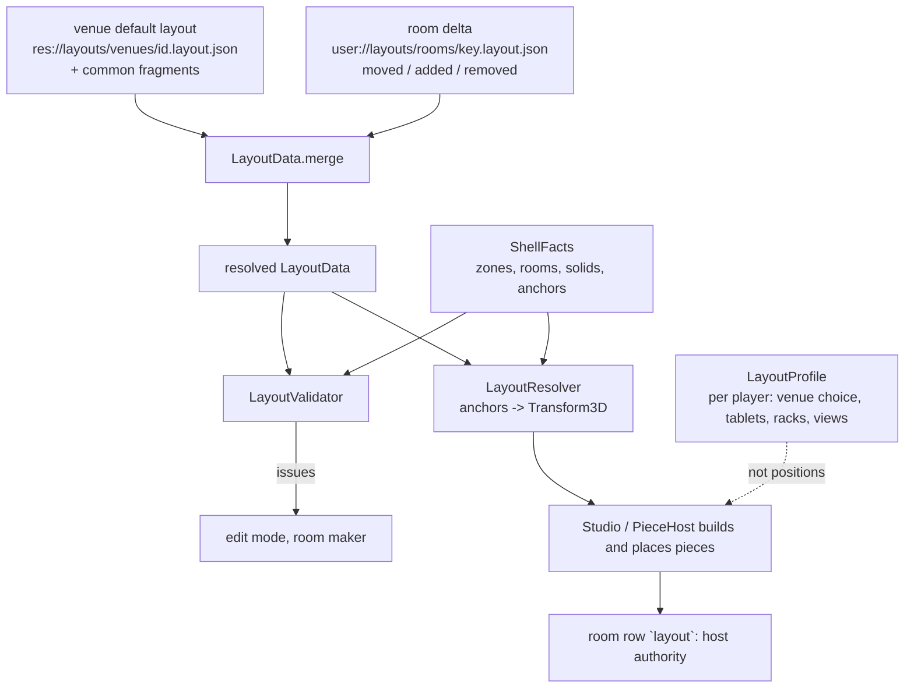

# Layouts: rooms as data

Status: **DESIGN, signed off 2026-11-07** (13). Migration steps 1 to 5 (11), step 8 and step 9 (edit ops, building, the F3 panel; 7), parts 1 to 3 of step 6 and step 7 (the 14 venue files and the roulette room) are built; the game reads them for the five wheeled pieces, the four zone-mounted ones (`LiveRoom`, `PieceHost`) and the control room's eight trolleys (`ControlRoom`), and `Neighbourhoods` is the layouts' `groups`:
`core/layouts/` (`LayoutData`, `LayoutCheck`, `LayoutMerge`, `LayoutSet`, `LayoutProblem`, `ShellFacts`, `LayoutResolver`,
`LayoutValidator` with `LayoutChecks`, `LayoutIssue`, `LayoutReach`, `LayoutGeometry`, `PieceFeet`, `LiveRoom`, `ControlRoom`, `FloorImport`, `VenueCatalogue`, `ShellBuilders`), `layouts/common/live_room.layout.json`, `layouts/common/control_room.layout.json`, `layouts/import/floor_v1.json`, `layouts/venues/<id>.layout.json` (15 files),
`layouts/layout.schema.json`, fixtures in `tests/fixtures/layouts/`. Where they differ from the text below, the
text says so ("Built:"). It is queue item 2 of `docs/refactor_loop.md` and feeds items 6-8. "Today" claims cite `docs/refactor_state_map.md` (SM) or
a file:line. Companion: `docs/mods.md` (manifests, registry; a piece is delivered as a mod entry).

## 1. Terms

| Term | Meaning |
|---|---|
| **Room** | What a player stands in: a shell plus a layout. The 14 venues, each in 3 arrangements, and the roulette room are the rooms that exist today (`Venue.IDS`, `venue.gd:21`; `Venue.VARIANTS`, `:31`). |
| **Shell** | The walls, ground, sky and fixed solids. Code today (`XVenue._ready`, SM 2.2). It reports its geometry as **shell facts** (3). |
| **Layout** | A JSON file: which shell, which pieces stand where, how they are grouped and wired, what is attached. |
| **Arrangement** | One of a venue's variants (Dusk / Golden hour / Night). In a layout: an entry in `variants` that overrides part of it. |
| **Piece** | Anything that stands in a room and is placed by the layout: a station, a trolley, a shelf, the venue's instrument, the modular annex. Defined once in a **piece definition** (4), placed many times. |
| **Single item** | A piece that sits in any room: small, a footprint on the floor or a mount on a wall, a zone or a shelf. Cassette rack, sampler, hoop, tablet. |
| **Room-scale mod** | A piece that needs a room of its own: it claims real estate beyond the live room and a doorway. Today only the modular room (`ModularAnnex`). |
| **Anchor** | A named point or line the shell provides: `wall.left`, `control_rear`, `zone.synth`, `annex_edge`. Placements are written relative to anchors so they follow the room's width. |
| **Slot** | A place inside a piece that holds smaller things (the prop shelf's item spots, `Venue.item_spots`, `venue.gd:412`). Slots belong to the piece definition, not the layout. |
| **Wiring** | Declared relations between pieces: what feeds, rides on or opens onto what. Today these are fields of `Studio` and `if` branches. |
| **Zone** | One of the five activity boxes (bricks, matrix, drums, vocals, synth, `Venue.ZONES`, `venue.gd:65`). |

Goals and tests this must keep (SM 2.6): every piece clear of every other (`ROOM_CLEAR` 0.6 m,
`run_tests.gd:26733`) and of the footprint and solids, every station reachable from the mix position,
in all 42 venue/arrangement combinations.

A correction to the SM for this design: SM 2.2 counts "11 of 14 venue files override `*_spot`".
Comparing function names with `venue.gd`, those overrides are scenery (`pole_spots`, `chair_spots`).
The overrides that matter for placement are few: every venue overrides `rooms()` and `zone_solids()`;
`studio_venue.gd` also `zones()` (`:154`) and `default_prop_shelf_spot()` (`:185`); `greenhouse_venue.gd`
`annex_edge()` (`:274`); `roulette_room.gd` `live_room_half`, `solids`, `zones`, `rig_roulette_spot`. That
makes the conversion much smaller than SM 5.2 point 8 feared.

## 2. Architecture



Three layers of position, top wins:

1. **Venue default** (shipped, read-only): `res://layouts/venues/<id>.layout.json`, which `extends` shared
   fragments in `res://layouts/common/` (control room, standard live room), so the 14 files hold only what differs.
2. **Room delta** (the host's, shared): `{base, variant, moved, added, removed}` in
   `user://layouts/rooms/<key>.layout.json`. "Reset to default" is deleting entries from it.
3. **Per player** (`LayoutProfile`, `core/presentation/layout_profile.gd`): venue choice, tablets and
   track racks, view modes. **Not piece positions** any more (6).

## 3. Shell facts: validating without building a room

The placement tests build a full `Studio` and a venue's geometry for each of 42 combinations (SM 5.2
point 12). Validators must not. `ShellFacts` is the pure data a shell reports:

```
class_name ShellFacts extends RefCounted
  var room_width: float            # Studio.room_width (11.2 base), grows in 0.8 m steps
  var footprint: Rect2             # the working footprint (control room)
  var rooms: Array[Rect2]          # Venue.rooms(): walkable floor
  var solids: Array[Dictionary]    # {c, h, a, top}: Venue.solids() + zone_solids() + instrument/weather solids
  var zones: Dictionary            # id -> AABB (Venue.zones())
  var live_room_half: float        # Venue.live_room_half()
  var annex_edge: float            # Venue.annex_edge()
  var has_walls: bool
  func anchor(name: StringName) -> Variant   # Vector2/float, null if the shell has none
  static func of(venue: Venue) -> ShellFacts  # reads an un-readied Venue (no children)
```

`Venue.make(id, v)` followed by `facts()` must not need `_ready` (it must not read child nodes). Step 2 proves
this by comparing `ShellFacts` from an un-readied venue with one from a built venue for all 42 combinations
(and the roulette room). No venue's `solids()` reads nodes, so nothing had to become a constant (see "Built" below).

**Built (step 2)**, `core/layouts/shell_facts.gd`, differences from the sketch above:

* Extra fields `venue_id`, `variant` and `ceiling` (`Venue.ceiling_height()`, where a person stops going up); `to_dict()` and
  `ShellFacts.differences(a, b)` (names of facts that differ, numbers within 1e-5) exist for the equivalence test and for tools.
* `footprint` is the bounds of `Venue.footprint_corners()`, i.e. the 0.05 m inset rectangle the placement tests measure with.
* `solids` is the shell's own: `zone_solids()`, the instrument's, the weather's and the roulette door (what `Venue.solids()` holds),
  **without the five wheeled pieces**. They are pieces, and `Venue.solids()` adds them only when no trolley stands in for them. It is
  `Venue.solids()` minus `Venue.wheeled_solids()`, so a shell that adds a solid of its own in `solids()` (the roulette room's
  setup-wall post) is kept. Step 5 did not turn this into a plain call: `wheeled_solids()` (the pieces' walker footprints) is still the venue's, and moves with the pieces in step 6.
* `anchor(name)` returns a float for a line (`wall.left`, `control_rear`, `annex_edge`, `zone.<id>.cx|cz`), a `Vector2` for a point
  (`zone.<id>` is the middle, `.min`/`.max` the corners) and null when the shell has no such anchor (a zone it lacks). `anchor_axis(name,
  "x"|"z")` reads either as a number. `ShellFacts.is_anchor_name` is the syntax (`ANCHOR_RE`, also in the schema).
* A shell can be described without a venue: `ShellFacts.new()` and set the fields (the `box` kit of the maker will do this).

**What needs `_ready`: nothing a fact reads.** The state map left this unverified; it was checked two ways. By reading: the only
venue code that reads child nodes and is reachable from a placement question is `lyrics_spot` and `mic_spot` (`find_child("MicStand")`,
for the felt's height under the stand: a piece's spot, not a shell fact), `hoops()` (`get_node_or_null("Hoop")`, the node beside a
computed shape) and `ZoneKit.yield_rack` (visibility). `rooms`, `zones`, `zone_solids`, the instrument's and weather's specs,
`live_room_half`, `annex_edge`, `has_walls`, `ceiling_height`, `footprint_corners` and `door_solid` are constants, `variant` and
`room_width`. By test: `_test_shell_facts_from_an_unreadied_venue_match_the_built_one` compares facts from a venue made and never
entered into a tree with the same venue after `_ready`, for the 42 combinations and the roulette room, each at the base width and 3.2 m
wider (86 comparisons, none differs), and `_test_shell_facts_of_a_venue_in_a_studio_are_the_unreadied_ones` against the venue a real
`Studio` built for each of the 43. `rich` only changes shadows, so it is not varied. So "where a `solids()` reads nodes the solid becomes
a constant" (below) turned out to be needed nowhere. `lyrics_spot`/`mic_spot` will need it when step 6 makes the lyric board a piece:
the booth's felt height is then a constant of the zone kit.

`ShellFacts.can_cut(wall, z, width)` (step 4) answers whether a doorway can be cut in a side wall; see 6.

`ShellFacts.anchors_of(venue)` (step 5) is the part `of` starts from: id, arrangement, width, zones, `live_room_half`, `annex_edge`, and no solid. `Venue.default_spot` resolves against it, because `of` asks the venue for `solids()`, which asks for the wheeled pieces' spots, which are `default_spot`.

**Built (step 6, part 3)**: one more anchor, `height.control_header` (`Studio.WALL_HEIGHT` + `ShellFacts.HEADER_ABOVE` 0.45: the header over the control room's open rear, where the MIXING banner hangs). `LayoutResolver.place(at, facts)` is the public form of the non-frame branch of `of`, for a placement that is not a piece's (a group's `banner`). `ANCHOR_RE` and the schema carry the anchor.

**Built (step 6, part 2)**: two more anchor forms, both heights, for the zone-mounted pieces: `height.table` (the bricks table's top,
`ZoneKit.TABLE_HEIGHT`) and `zone.<id>.floor` (the floor at the zone's middle: the riser's top where the zone has a stepped riser, else 0;
`ShellFacts.zone_floors`, from `Walker.ground_of(zone_solids())`, the very call `Venue.drum_floor` made). `ANCHOR_RE` and the schema carry them.

Anchors the shell provides (names are the contract): `wall.left`, `wall.right` (x of the live room's
side walls, +-`live_room_half`), `control_wall.left|right` (+-`room_width/2`), `control_rear` (z =
`Studio.ROOM_BACK` = 4.0), `live_back` (`LIVE_ROOM_BACK` 12.4), `mix` (`Studio.MIX_POSITION_Z` 0.66),
`zone.<id>` (centre; `.cx`, `.cz`, `.min`, `.max`), `annex_edge`.

## 4. Pieces

### 4.1 Piece definition

A piece definition is a mod entry of kind `piece` (`docs/mods.md` 3.2), so a mod can add one. The built-in
ones live in `res://mods/builtin/pieces/`. It replaces a `Stations.ALL` row (24 rows with strings naming
`Venue` methods, `stations.gd`), a `LIVE_TROLLEYS` entry (`studio.gd:1790`), a `Venue.WHEELED` id and a
branch in `_carry_live` (`studio.gd:1940`).

| Field | R/O | Meaning |
|---|---|---|
| `id`, `title` | R | e.g. `cassette_rack`, "CASSETTE RACK" |
| `class` | R | `single` or `room_scale` |
| `builder` | R | a name in the code-side `PieceBuilders` table (one list) that makes and moves the node: `CassetteRack`, `Sampler`, `ModularAnnex` |
| `mount` | R | `floor` \| `wall` \| `zone` \| `surface` \| `venue` \| `shelf` |
| `mobility` | O | `wheeled` or `fixed` (default `fixed`); the layout may override per placement |
| `footprint` | R for floor | `{"half":[x,z],"offset":[x,z]}` and `top`: the same numbers `Stations` `foot`/`foot_z`/`top` and the trolley use, once |
| `trolley` | O | `{"weight":9.0,"grips":[...]}` (`LIVE_TROLLEYS`) |
| `needs` | O | zone ids it cannot stand without (`["synth"]` for the sampler, `default_sampler_spot` returns null without one, `venue.gd:658`) |
| `station` | O | `area`, `air`, `seat`, `reach`, `at`, `frame`, `desk`/`hands` help: the rest of the `Stations` row |
| `slots` | O | named places inside it that hold items |
| `followers` | O | what rides with it when it moves (the shelf's toys, the rack's cassettes: today `_carry_live`) |
| `claims` | R for `room_scale` | see 4.3 |
| `limit` | O | max copies per room (1 for `modular_annex`) |

**Built (step 6, first part)**: the code side of the definition exists for the five wheeled pieces. `PieceDef`
(`core/layouts/piece_def.gd`) has `id`, `kind` (`SINGLE`), `trolley_name`, `foot_centre`/`foot_half`/`top`, `weight`, `grips`,
`body_centre`/`body_half` (the hoop's pole), `needs` (the sampler: `synth`), the node it moves (`studio_node` or `venue_child`,
`node_in_set`) and `followers` (`HOLD_RACK`, `HOLD_RACK_IF_GONE`, `SPILLS`, `BOARDS`, `HOOPS`, `ITEMS`); `PieceDef.of(id)` /
`has` / `ids()`. The numbers are the classes' own constants, written once in `_build()`, and are not in JSON (the doc's `footprint`
and `trolley` fields stay the data form for when a mod can add a piece; the layout file has only placements). `PieceHost`
(`core/layouts/piece_host.gd`, held as `Studio.pieces`) is what `studio.gd` lost: `build()` makes each trolley from its definition
(was `LIVE_TROLLEYS` + the loop in `_build_live_pieces`), `carry(id)` moves the node to `venue.<id>_spot()` and runs the followers
(was four of the six `_carry_live` arms; `station_board`, `patch_wall` and `mini_table` stay in the studio, they are not in the
five), and `rehome_items`, `rehome_spills`, `hold_the_rack` moved over from the studio. `PieceFeet` reads `PieceDef`; `Studio.LIVE_TROLLEYS`
is gone. Not yet: the `piece` mod entry, `PieceBuilders`, `station`, `slots`, `claims` and the annex as a definition.

**Built (step 6, part 2)**: `PieceDef` gains `mount` (`WHEELED`, `ZONE`, `VENUE`) and seven zone/venue definitions: `wheel`, `sections`, `drums`
(the studio's `drum_circle`), `looper`, `lyrics` (`lyric_board`) and the shell's `venue` (instrument) and `weather` (`studio_node` names the
studio's variable). `PieceDef.ids()` is still the five wheeled; `PieceDef.standing()` is the order `PieceHost.stand_all` stands the rest in
(`wheel, sections, cassette_rack, sampler, drums, looper, lyrics, venue`; the weather by itself, after the modular rack). `PieceHost.stand(id)`
replaced nine of the studio's `_stand_the_*` functions (wheel, sections, cassette rack, sampler, drum circle, looper, lyrics, venue instrument,
weather; 172 lines of `studio.gd`): it asks `Stations.spot` (or the shell's `instrument()`/`weather()` spec for the two the shell describes), makes
the node (`PieceHost._make`, one arm per piece, with the studio's signal handlers wired as they were: the sampler keeps its REC across a venue, the
looper takes over a layer from the last one), sets the studio's variable and hangs it on the venue. A venue with no room for a piece (no bricks
table, no riser, no booth, no weather) leaves the variable null. `PieceFeet.known` means "has a footprint" (wheeled only) and `mounted` "has none
because it is in a zone or the shell's": the validator skips those instead of warning, the zone standing in for them as before.

What moved to data (all in `layouts/common/live_room.layout.json`; the old code is frozen in `tests/fixtures/layouts/zone_pieces_legacy_spots.json`,
336 transforms over 43 rooms at two widths plus 8 nulls for the roulette room, held by `_test_the_zone_mounted_pieces_stand_where_the_old_code_stood_them`):

| Piece | Placement | Replaces |
|---|---|---|
| `wheel` | `zone.bricks.cx|cz`, pos (0, -0.94), `up: height.table`, yaw pi | `Venue.wheel_spot` body (`WHEEL_IN` stays as a constant: the wheel's plaque hangs off the same edge) |
| `sections` | `zone.bricks.cx|cz`, pos (0.30, 0.29), `up: height.table`, yaw -pi/2 | `band_spot` (deleted) and `sections_spot` body; `TABLE_BANDS` stays as the clearance bands the tests measure |
| `drums` | `zone.drums.cx|cz`, `up: zone.drums.floor`, yaw `{toward: mix, snap: pi/2}` | `drum_circle_spot(-1)` body; `drum_ring` stays, static, for drum `n` and `ZoneKit.solids` |
| `looper` | frame `authored:drums`, local (-0.98, 0.98), yaw 0 | `looper_spot` body; `looper_at` stays, static, for `ZoneKit.solids` |

Two keys were added to `at` for these (and to the schema, `LayoutCheck`, `LayoutResolver`): **`up`**, the origin's height, a number of metres or an
anchor name read as a height (default 0: everything before stood on y = 0); and **`yaw` may be `{toward: <anchor>, snap: radians}`**: turned to face the
anchor from where the piece stands (a line such as `mix` is the point (0, value)), rounded to a multiple of `snap`. Both are about the facts the shell
reports, so they keep a layout meaningful in a wider room or another arrangement.

**Not moved, and why.** `lyrics`: its spot reads the booth's mic stand node (`find_child("MicStand")`) for the felt's height, so it needs a built
shell; it becomes data when the booth's felt is a constant of the zone kit (3, `lyrics_spot`). `venue` (instrument) and `weather`: the shell supplies
the spot, which is each of the 14 files' own geometry (`back_wall_instrument`, a window's sill); they move with the venue files (step 7). `modular`
(`_stand_the_modular`, `_stand_the_annex`): the rack's spot is `ModularAnnex.rack_spot`, a scaled transform (1.2) that `at` cannot say, and it is
a room-scale piece (step 11). The control-room furniture rows (`stage_table`, `eq_wall`, `levels`, `tv`, `platter`, `miniature`) are the studio's
`_build_furniture`, wheeled or hung by `SessionLayout`, not stood by `_stand_the_*`; they wait for the control-room fragment. The `Stations.ALL`
rows themselves (title, help lines, look point, frame, seat) are written in terms of the pieces' class constants (`RackWall.FRAME_TOP`,
`Looper.PLAQUE_FOOT`, ...) and stay code until the `station` field and `PieceBuilders` exist; their `spot` method names now resolve to the layout for
the nine pieces that are in it. The groups `rhythm`, `harmony` and `vocals` are in the live-room fragment now (part 3); `lyrics` is listed there as a piece with no `at`, so that the vocals group does not name a piece the room lacks.

**Built (step 6, part 3)**: the control-room fragment `layouts/common/control_room.layout.json` (`common.control_room`, loaded by `ControlRoom`, not yet `extends`ed by the venue files: that is step 7) holds the furniture rows of `Studio._build_furniture`: `stage_trolley` (`yaw: {toward: mix}`), `eq_wall` (anchored to `control_wall.right`, so it follows the wall out as the room widens), `deck_trolley`, `rack`, `patch_stand`, `patch_wall` (anchored to `control_wall.left`), `station_board` and `mini_table`, and the riders `stage_table` and `platter` as `rides` wires to their trolleys. Their ids are the trolleys' piece ids; `Studio._authored(name, id)` builds each where `ControlRoom.trolley_args` says, in the room's width. `STAGE_AT`, `EQ_WALL_IN/Z/HEADING`, `_eq_wall_at`, `PATCH_STAND_AT/HEADING`, `_patch_wall_default`, `BOARD_AT/HEADING`, `MINI_TABLE_AT/HEADING` and `SessionLayout`'s `RACK_AT/HEADING`, `DECK_AT/HEADING`, `PATCH_AT/HEADING` are gone. A new placement key, `fit` (`{at: [x, z], yaw}`), is where the rack and the deck stand for the thirteen-track desk that `SessionLayout.fit` reproduces (it keeps the rule: the gaps, the halves and the clearance), which is not where they are first built. The frozen fixture `tests/fixtures/layouts/control_room_legacy.json`, dumped from the code before it was deleted, holds the trolleys at four room widths, `fit` for five desks, the old `Neighbourhoods.ALL` rows, the MIXING banner's frame and 4536 probes of `was_an_old_default`.

Not moved, and why: `levels` and `tv` (the venue's: their inset depends on `back_wall_gear_stands`, which is a fact of the built wall, not in `ShellFacts`; the layout's entries carry no `at`), the timeline stand (its z is `Studio.TIMELINE_Z - 0.04`, derived from the surface it holds) and the lamp stands (a lamp and its light are one row of `Studio.PRACTICALS`, widened by `SessionLayout.widen`).

### 4.2 Catalogue of today's things

| Piece | Class | Mount | Mobility | Today |
|---|---|---|---|---|
| `cassette_rack`, `sampler`, `tour_case`, `prop_shelf`, `hoop` | single | floor | wheeled | `Venue.WHEELED` (`venue.gd:889`) |
| `wheel`, `sections`, `drums`, `looper`, `lyrics` | single | zone | fixed | `Stations` `zone` field |
| `stage_table`, `eq_wall`, `levels`, `tv`, `platter`, console, rack trolley, patch stand | single | floor / surface / cart | wheeled | `Studio._build_furniture` (`studio.gd:1229-1770`) + `SessionLayout`; part of the control-room fragment |
| venue instrument, weather switch | single | venue | fixed | `Stations` `mounted`, `weather`; the shell supplies the spot |
| plugin tablets, track racks | single | floor | wheeled, player-owned | `studio.gd:2056-2438` |
| toys, tablet, instruments on the prop shelf | item | shelf slot | picked up | `ItemRoom`, `item_spots` |
| `modular_annex` | **room_scale** | beyond wall | fixed | `ModularAnnex`, built onto every venue (`modular_annex.gd`, SM 1.3) |

Held stations (fingertips, clap, lean, jacks, `Stations` `HELD_AREA`) are not pieces: they have no place.
Items are not placed by a layout; their shelf is.

### 4.3 Single item or room-scale mod, and how it claims space

`class` is in the definition, never in the layout, so a layout cannot make a big thing small. A
single item has a floor footprint (or a mount) inside the live room and is validated as in 6.
A room-scale piece declares what it takes:

```
"claims": {
  "site":  {"beyond": "wall.right", "span_z": [6.0, 13.0], "depth": 8.0, "height": 4.4},
  "door":  {"z": 9.0, "width": 1.9, "height": 2.35},
  "clear_in_front_of_door": 1.2
}
```

(these are the `ModularAnnex` constants `Z_FROM`/`Z_TO`/`DEEP`/`HEIGHT`/`DOOR_Z`/`DOOR_WIDE`/`DOOR_HIGH`,
`modular_annex.gd`). The validator checks that no other room-scale claim overlaps the site, that the wall
at the door can be cut (a shell fact `can_cut(wall, z, width)`, today `cut_the_wall`, `:648`), and that
nothing stands in the doorway's walkway. The piece's builder adds its own `floors()` to the walkable
rooms (as `Venue.walk_rooms` does, `venue.gd:596`) and its `solids()`. The annex then becomes one
piece the layout lists or omits, instead of `Studio._stand_the_annex` for every venue
(`studio.gd:4739`); the roulette room omits it (today `modular_spot` returns null there, `venue.gd:588`).

## 5. The layout file

### 5.1 Schema (abridged)

```json
{
  "$schema": "https://json-schema.org/draft/2020-12/schema",
  "title": "dawlings layout, version 1",
  "type": "object",
  "required": ["format", "version", "id", "title"],
  "properties": {
    "format": {"const": "dawlings.layout"},
    "version": {"const": 1},
    "id": {"type": "string", "pattern": "^[a-z][a-z0-9_-]{0,39}$"},
    "title": {"type": "string"},
    "extends": {"type": "array", "items": {"type": "string"}},
    "order": {"type": "integer", "description": "position in the venue cycle (Venue.IDS order)"},
    "shell": {"type": "object", "properties": {"builder": {"type": "string"}, "kit": {"type": "string"}, "size": {"type": "string"}}},
    "mood": {"type": "object", "properties": {"base": {"type": "string"}, "hit": {"type": "string"}, "glow": {"type": "number"}}},
    "zones": {"type": "object", "additionalProperties": {"type": "object", "required": ["min", "size"], "properties": {"min": {"type": "array"}, "size": {"type": "array"}, "grow": {"enum": ["outward", "none"]}}}},
    "pieces": {"type": "array", "items": {"$ref": "#/$defs/placement"}},
    "groups": {"type": "array", "items": {"type": "object", "required": ["id", "title", "members"]}},
    "wiring": {"type": "array", "items": {"type": "object", "required": ["kind", "from", "to"], "properties": {"kind": {"enum": ["feeds", "rides", "loom", "opens_onto"]}}}},
    "variants": {"type": "array", "minItems": 1, "items": {"type": "object", "required": ["title"]}}
  },
  "$defs": {
    "placement": {"type": "object", "required": ["id", "piece"], "properties": {"id": {"type": "string"}, "piece": {"type": "string"}, "at": {"type": "object"}, "mobility": {"enum": ["wheeled", "fixed"]}, "enabled": {"type": "boolean", "default": true}}}
  }
}
```

`at` is `{"anchor": {"x": "<name>", "z": "<name>"}, "pos": [dx, dz], "yaw": radians}`: the position is
the anchors' values plus `pos` (an absent anchor means the floor's origin), `yaw` is about +Y as in
`Transform3D(Basis(Vector3.UP, yaw), ...)`. `{"frame": "authored:<piece id>", "local": [x, z], "yaw": r}`
places a piece in another's authored frame (not its pushed one; this is what `default_cassette_rack_spot`
does, `venue.gd:641`). A zone-mounted piece has no `at`: its definition's zone-relative rule applies.
(**Built, step 6 part 2**: that is superseded for the four whose rule was arithmetic on a zone box. They have an `at` against the zone's anchors;
see 4.1 "Built (part 2)" and the two extra `at` keys there.)

`variants[i]` may carry any of `zones`, `pieces` (merged by `id`; `"enabled": false` removes), `groups`,
`wiring`. Variant 0 is the base. Merge rule: objects merge by key, arrays of `id`-bearing objects merge by
`id`, other arrays replace.

**Built (step 1)**, `LayoutData` (parse), `LayoutCheck` (field rules), `LayoutMerge` (merge), `LayoutSet` (scan, resolve), with
these rules made exact; each is a clarification or a deviation from the text above:

* **Layout ids may be dotted** (`common.live_room`, the id the worked example already uses); the schema pattern in 5.1 above
  forbade the dot. Pattern: dotted words of `[a-z][a-z0-9_-]{0,39}`. Piece, zone, group ids: `[a-z][a-z0-9_]{0,39}`.
* **`null` removes a key** when merged (`"zones": {"synth": null}` drops a zone; this is how a made room, or the roulette room, has
  fewer zones than its fragments).
* **`at` replaces whole** when merged (an override must be able to swap an anchor placement for a frame one, not leave half of each).
* **`wiring` entries have no `id`**: they merge by `kind|from|to`, and `"enabled": false` removes one. (Replacing the list would have
  lost the live room's `feeds` wire from any venue that lists its own wiring, as the rooftop example does.) `groups` merge by `id`.
* **`enabled: false` survives merging** (so a later fragment can switch a piece back on) and is taken out last, by `LayoutMerge.settle`,
  which also drops the group members and wires that named a removed piece. A piece removed from a room therefore leaves no stale
  reference; a member that never existed is a warning (`unknown_piece`).
* **Order of merging**: each `extends` entry, in order, each expanded first; then the file's own body; then the chosen variant
  (without its title); then `settle`. Only the file being resolved contributes `variants`; a fragment's are ignored. Fragments nest
  at most 8 deep. `order: null` or absent = not cycled.
* **A fragment or variant may carry part of an entry** (`{"id": "prop_shelf", "at": {...}}`, a zone with only `min`). Completeness
  is checked on the merged room: every piece has `piece`, every zone `min` and `size`, every group a `title` and `members`.
  Frames (`authored:<id>`) must name a piece of the room and must not loop. At most 64 pieces after the merge (`over_limit`).
* **Parser problem codes** (`LayoutProblem`, file-level; `error` makes the layout unusable, `warning` is only reported):
  `no_file`, `bad_json`, `bad_schema` (the section's `schema`), `unknown_key` (warning, ignored), `version_unsupported`,
  `duplicate_id`, `unknown_anchor` (syntax only; whether the shell has it is `ShellFacts.anchor`), `unknown_piece` (a frame, group
  member or wire end naming a piece not in the room; a warning for groups and wires), `cycle` (frames), `extends_missing` (also
  raised for a fragment that cannot be used), `extends_cycle` (also for nesting deeper than 8), `id_collision` (two files, one
  id: the first wins), `bad_variant`, `over_limit`. They are not the `LayoutIssue` codes of 6, which need a shell and come in step 4.
* **Not yet checked** (needs the piece catalogue or the shell, so step 4): that `piece` names a known definition, `mobility` against
  the definition, `grow` against the shell, and the 16 kB delta limit (a room-delta property, step 8).
* `shell.size` is any short name until queue slice 8 settles the sizes (decision 4); no size is designed here.

### 5.2 Worked example: the rooftop, today's numbers

**Built (step 3)**: the shipped `res://layouts/common/live_room.layout.json` holds the five wheeled pieces, the `feeds`
wire and the `synth` and `tape` groups (the other four groups wait for their members, step 6). It differs from the
JSON below in one way: `hoop` and `tour_case` are placed in the **authored frame of `prop_shelf`**
(`{"frame": "authored:prop_shelf", "local": [-0.4, 3.31], "yaw": pi}` and `[-2.0, 3.21]`), not against `wall.left`,
because the code derives them from `default_prop_shelf_spot()` (`_toys_wall(shelf)`): with the wall anchors the studio's
"Live room beside" arrangement would have needed three variant entries instead of the shelf's one, as the text
below shows. `local` is the world offset turned into the shelf's frame (the shelf is turned a quarter, so
`local = (-dz, dx)`). The sampler keeps `zone.synth.cx|cz` with `pos [-1.7, 1.1]`, yaw pi, which is the code's
`SYNTH_MIDDLE`/`SAMPLER_RING` for a synth zone on the right-hand side and behind the desk, as it is in all 14
venues; a made room that puts the synth zone on the left or in front must place the sampler itself (the code's
`side`/`away` signs have no data form yet). Yaws are written to 16 digits. `_test_the_layout_resolves_to_the_venues_own_defaults`
holds all five to `Venue.default_spot` within 1e-4 for 14 x 3 + 1 rooms at two widths (428 transforms, the
roulette room's two missing samplers null on both sides).

**Built (step 5)**: the game reads this. `LiveRoom` (`core/layouts/live_room.gd`) scans `res://layouts/` once (static, kept), resolves a
venue's room (`layouts/venues/<id>.layout.json` when there is one, else `common.live_room`; a venue without a file has no arrangements
of its own, so variant 0 whatever its arrangement) and `Venue.default_spot(id)` reads the transform from it against `ShellFacts.anchors_of(self)`,
kept on the venue until its arrangement or width changes. What was deleted from `venue.gd`: the bodies of `default_prop_shelf_spot`,
`default_hoop_spot`, `default_tour_case_spot`, `default_cassette_rack_spot`, `default_sampler_spot` (kept as one-line readers because tests and
`studio_venue.gd` call them), the `match` of `default_spot`, `_toys_wall`, and the constants `TOYS_IN`, `HOOP_ALONG`, `TOUR_CASE_ALONG`,
`RACK_GAP`, `SAMPLER_RING`; from `studio_venue.gd` the whole `default_prop_shelf_spot` override and `BESIDE_TOYS_IN`, now the one variant
entry of `layouts/venues/studio.layout.json` (arrangement 1, the shelf at `control_wall.left` + (0.34, 2.4)). `Venue.WHEELED` is no longer a
constant list but `LiveRoom.wheeled_ids()`: the `mobility: wheeled` pieces of the fragment, in file order (the fragment's pieces are written
in the order the studio has always built the trolleys, which decides the order they are settled in). `TOYS_ACROSS` and `SYNTH_MIDDLE` stay: the
venues' pendants and `synth_middle()` measure from them, and they are the neighbourhood's, not a piece's position. The 428-transform test
`_test_the_layout_resolves_to_the_venues_own_defaults` is now a regression check against the frozen fixture
`tests/fixtures/layouts/live_room_legacy_spots.json` (the old code's output for 43 rooms at two widths, dumped before the code was deleted).
**Not switched, and why**: `Studio.LIVE_TROLLEYS` is the trolleys' footprints, weights and grips, built from the classes' own constants
(`CassetteRack.FOOT`, `Hoop.BASE_HALF`, ...); a layout file has a placement and no such field, and writing the numbers into JSON would
duplicate the classes' constants. It waits for the piece definitions of step 6 (4.1 `footprint`, `trolley`); `PieceFeet` reads it until then.
The five `_carry_live` arms hold no position, only what rides on the piece (rehome the items, hold the rack, the hoops, the spills): they
already take the spot from `venue.*_spot()`, which now reads the layout, and are the `followers` of step 6.

The rooftop (`rooftop_venue.gd`, 858 lines) overrides none of the placement functions; it stands on the base
class (SM 2.2), at base width (`room_width` 11.2, so `live_room_half` 8.8 and zone growth 0). The five
wheeled pieces' defaults, from `venue.gd:399-540,641-672`:

| Piece | Formula in code | Resolves to (x, z, yaw) |
|---|---|---|
| `prop_shelf` | x = -half + 0.08 + `SHELF.z`/2 (0.21), z = `ROOM_BACK` + `TOYS_IN` 1.0, yaw pi/2 | -8.51, 5.0, 1.5708 |
| `cassette_rack` | shelf frame, local (-(0.475 + `RACK_GAP` 0.65 + `FOOT.x` 0.22), -0.21 + `FOOT.y` 0.1) | -8.62, 6.345, 1.5708 |
| `hoop` | x = wall (-8.8) + `TOYS_ACROSS` 3.5 + 0.1, z = shelf z + `HOOP_ALONG` 0.4, yaw -pi/2 | -5.2, 5.4, -1.5708 |
| `tour_case` | x = wall + 3.5, z = shelf z + `TOUR_CASE_ALONG` 2.0, yaw -pi/2 | -5.3, 7.0, -1.5708 |
| `sampler` | synth zone centre (8.3, 11.0): x - `SYNTH_MIDDLE` 1.7, z + `SAMPLER_RING` 1.1, yaw pi | 6.6, 12.1, 3.1416 |

Shared fragment, `res://layouts/common/live_room.layout.json`:

```json
{
  "format": "dawlings.layout",
  "version": 1,
  "id": "common.live_room",
  "title": "Standard live room",
  "pieces": [
    {"id": "prop_shelf", "piece": "prop_shelf", "mobility": "wheeled", "at": {"anchor": {"x": "wall.left", "z": "control_rear"}, "pos": [0.29, 1.0], "yaw": 1.5708}},
    {"id": "cassette_rack", "piece": "cassette_rack", "mobility": "wheeled", "at": {"frame": "authored:prop_shelf", "local": [-1.345, -0.11], "yaw": 0.0}},
    {"id": "hoop", "piece": "hoop", "mobility": "wheeled", "at": {"anchor": {"x": "wall.left", "z": "control_rear"}, "pos": [3.6, 1.4], "yaw": -1.5708}},
    {"id": "tour_case", "piece": "tour_case", "mobility": "wheeled", "at": {"anchor": {"x": "wall.left", "z": "control_rear"}, "pos": [3.5, 3.0], "yaw": -1.5708}},
    {"id": "sampler", "piece": "sampler", "mobility": "wheeled", "at": {"anchor": {"x": "zone.synth.cx", "z": "zone.synth.cz"}, "pos": [-1.7, 1.1], "yaw": 3.1416}},
    {"id": "wheel", "piece": "wheel"},
    {"id": "sections", "piece": "sections"},
    {"id": "drums", "piece": "drums"},
    {"id": "looper", "piece": "looper"},
    {"id": "lyrics", "piece": "lyrics"}
  ],
  "groups": [
    {"id": "rhythm", "title": "RHYTHM", "colour": "#FF9E6B", "members": ["drums", "looper"]},
    {"id": "harmony", "title": "HARMONY", "colour": "#9EDBFF", "lift": -0.4, "members": ["wheel", "sections"]},
    {"id": "synth", "title": "SYNTH & SOUND DESIGN", "colour": "#C7A8FF", "lift": 0.25, "members": ["sampler"]},
    {"id": "vocals", "title": "VOCALS", "colour": "#FFB3D1", "members": ["lyrics"]},
    {"id": "tape", "title": "TAPE & TOYS", "colour": "#B3FFB8", "members": ["cassette_rack", "prop_shelf", "tour_case", "hoop"]}
  ],
  "wiring": [{"kind": "feeds", "from": "sampler", "to": "cassette_rack"}]
}
```

The groups are the layouts' `groups` now (step 6 part 3): `Neighbourhoods.all()` reads them, `mixing` from the control-room fragment (with its `banner`: `{anchor: {z: control_rear}, pos: [0, 0.12], up: height.control_header}`) and the others from the live-room fragment; a member with a `Stations` row is a station of the neighbourhood, any other (`prop_shelf`, `tour_case`, `hoop`) a piece that helps place its middle. The hex colours are a byte a channel, up to 1/510 off the old floats.
The `feeds` wire is "one sample, a WAV and a cassette on the rack" (`stations.gd`, sampler row).

The venue file, `res://layouts/venues/rooftop.layout.json`:

```json
{
  "format": "dawlings.layout",
  "version": 1,
  "id": "rooftop",
  "title": "Rooftop",
  "order": 6,
  "extends": ["common.control_room", "common.live_room"],
  "shell": {"builder": "RooftopVenue"},
  "mood": {"base": "#7399FF", "hit": "#FFB3E6", "glow": 0.75},
  "zones": {
    "vocals": {"min": [-8.7, 0.0, 9.2], "size": [3.4, 2.6, 3.1], "grow": "outward"},
    "drums": {"min": [-3.4, 0.0, 4.8], "size": [2.6, 2.8, 2.6], "grow": "outward"},
    "matrix": {"min": [0.0, 0.0, 8.6], "size": [3.4, 3.4, 3.4], "grow": "outward"},
    "bricks": {"min": [6.8, 0.0, 4.6], "size": [1.9, 1.3, 2.9], "grow": "outward"},
    "synth": {"min": [7.9, 0.0, 10.0], "size": [0.8, 2.0, 2.0], "grow": "outward"}
  },
  "pieces": [
    {"id": "modular_annex", "piece": "modular_annex", "at": {"anchor": {"x": "annex_edge"}, "pos": [0.0, 0.0], "yaw": 0.0}}
  ],
  "wiring": [{"kind": "opens_onto", "from": "modular_annex", "to": "live_room"}],
  "variants": [{"title": "Dusk"}, {"title": "Golden hour"}, {"title": "Night"}]
}
```

The annex resolves, at base width and the rooftop's `annex_edge` = `live_room_half` = 8.8
(`venue.gd:1275`): near wall centre x = 8.8 + `GAP` 0.63 + `WALL`/2 0.1 = 9.53; inside x 9.63 to 17.63,
z 6.0 to 13.0; doorway at z 9.0, 1.9 wide, 2.35 high; the rack at (17.49, 1.0, 9.2), yaw -pi/2, scale 1.2
(`ModularAnnex.rack_spot`, `modular_annex.gd:87`). The mood is `RackMood.MOODS[&"rooftop"]`
(`rack_mood.gd:15`: 0.45,0.6,1.0 / 1.0,0.7,0.9 / 0.75).

A variant that does change placement shows the idea. `studio` arrangement 1 ("Live room beside") overrides
`default_prop_shelf_spot` (`studio_venue.gd:185`) to x = `-room_width`/2 + 0.05 + 0.08 + 0.21, z = `ROOM_BACK` +
`BESIDE_TOYS_IN` 2.4, and `zones()` to `SIDE_ZONES` (`:51`). As data:

```json
{
  "title": "Live room beside",
  "pieces": [
    {"id": "prop_shelf", "piece": "prop_shelf", "at": {"anchor": {"x": "control_wall.left", "z": "control_rear"}, "pos": [0.34, 2.4], "yaw": 1.5708}}
  ],
  "zones": {
    "drums": {"min": [-9.6, 0.0, -3.4], "size": [2.6, 2.8, 2.6], "grow": "none"},
    "matrix": {"min": [-11.0, 0.0, 0.45], "size": [3.4, 3.4, 3.4], "grow": "none"},
    "vocals": {"min": [-14.5, 0.0, -3.9], "size": [3.4, 2.6, 3.1], "grow": "none"}
  }
}
```

(The real code subtracts `_grow()` from the side-room boxes, `studio_venue.gd:159`: a `grow` value `"inward"` is
added for it.) Studio's `rooms()` for this arrangement (`:171`) is shell facts and stays code.

### 5.3 The 14 venues, the roulette room and their 3 arrangements

* 14 files `res://layouts/venues/<id>.layout.json`, each with `variants` of 3 titles taken from `Venue.VARIANTS`
  (`venue.gd:31`). Only the studio's arrangements change placements or zones; in the other 13 a variant is a
  title and the shell builder reads the index.
* `roulette.layout.json`: one variant, `"order": null` (not cycled), `zones: {}`, no `modular_annex`, one piece
  `rig_roulette` at x -2.2, z -1.5, yaw 0.5, y 1.45 (`roulette_room.gd`). Its `live_room_half` and `solids`
  are shell facts. The pieces that need no zone (`prop_shelf`, `hoop`, `tour_case`, `cassette_rack`) stand as in the base
  class, inside the room's own half-width (`:39`); `sampler` has `needs: ["synth"]` and is skipped by the
  rule "a piece whose `needs` zone is missing is skipped, not an error".
* 42 combinations remain 14 x 3; the validator test (8) loops the files, not the classes.
* `Venue.IDS`, `Venue.make_title`, `Venue.variant_titles`, `RackMood.MOODS`, `VENUE_SETS` (tests) are (**built**, step 7)
  derived by scanning the layout directory, ordered by `order`. `Venue.make` becomes a lookup of
  `shell.builder` in one `ShellBuilders` table (the one list that must stay while shells are code).

**Built (step 7)**: the 14 files and `roulette.layout.json` exist under `layouts/venues/`. Each venue file has `id`, `title` (what `make_title` returned), `order` (0 to 13, the old `Venue.IDS` order), `extends: ["common.control_room", "common.live_room"]`, `shell: {"builder": "<Class>"}`, `mood` (the old `RackMood.MOODS` entry as hex colours and a glow) and `variants` (the old `Venue.VARIANTS` titles). The studio's file keeps its one placement variant (the shelf in "Live room beside"); no other venue overrides a placement, so the other thirteen have titles only. The roulette room's file has no `order` (never cycled), no `mood` and no `variants` (its one arrangement is its title), and the same two fragments: it has no zones, so the sampler and the four zone-mounted pieces are skipped with warnings as before.

* `VenueCatalogue` (`core/layouts/venue_catalogue.gd`) answers from the scanned set (`LiveRoom.layouts()`): `ids()`, `title_of`, `variant_titles`, `builder_of`, `mood_of`. `Venue.IDS` is now a `static var` set from it (`order`), `Venue.variant_titles`/`make_title` call it, and `Venue.VARIANTS`, the 14-arm `match` of `make_title` and `RackMood.MOODS` are deleted. A name nobody ships is the studio's title with one arrangement and `RackMood.FALLBACK`, as before.
* `ShellBuilders` (`core/layouts/shell_builders.gd`) is the one list that must stay while shells are code: `BY_NAME` maps the layout's `shell.builder` to the class, and `Venue.make` is `ShellBuilders.make(id)` (the 14-arm `match` is gone). A static var, not a const: class names are not constant expressions. A new venue is its layout file, its shell class and a line here.
* Mood colours are bytes (`#RRGGBB`), as groups' colours are: up to 1/510 off the hand-typed floats of the old table. The test holds them to a byte.
* Fixture `tests/fixtures/layouts/venue_tables_legacy.json` (dumped from the tables before they were deleted): ids and order, names, arrangements, moods, the roulette and unknown cases. Tests: `_test_the_venue_tables_are_the_layout_files`, `_test_fifteen_venue_files_are_shipped_and_valid` (`tests/venue_files_tests.gd`); `_test_every_layout_is_valid` now resolves the shipped file of each of the 43 rooms (path checked) instead of an in-memory stand-in, and `LayoutResolverTests.room` does too. 0 errors, the same 10 warnings.
* The validator treats the control room's furniture kinds as `PieceFeet.mounted` (they stand inside the working footprint, which it keeps as one block), so extending the fragment adds no warnings.
* Zones are **not** repeated in the venue files: the shells report them (`Venue.ZONES`, the studio's `SIDE_ZONES`) and a file that restated them would be a second copy to keep equal. The `zones` key stays for made rooms, which have no shell class to ask. For the same reason the files do not list `modular_annex` (the studio stands it on every venue until step 11).
* **Not moved, and why.** The venue's `instrument()` and `weather()` specs (spot, kind, and per-kind extras such as `hang_to`, `sill`, `glass`) are built from each shell's own constants (`LEFT_BAYS`, `SILL`, `WALL`, `CHIMES_ALONG`, `piano_case()`) and, for weather, from the arrangement; a layout entry would restate those numbers beside the shell that already has them, so they stay in the 14 classes until a shell form exposes its bays as anchors (step 11/12). `lyrics` still reads the booth's mic stand. The `Stations` text rows (title, help, look point, frame) are written against class constants (`RackWall.FRAME_TOP`, `Looper.PLAQUE_FOOT`) and wait for `PieceBuilders`. The roulette room's `rig_roulette_spot` stays: it is one line in the class and the anchors have no front-wall line to write it against.

## 6. Validators

`LayoutValidator` is pure: layout + `ShellFacts` in, issues out. No `Studio`, no nodes.

```
class_name LayoutIssue extends RefCounted
  var code: StringName     # see below
  var severity: int        # ERROR | WARNING
  var piece: StringName    # offender
  var other: StringName    # what it clashes with, if any
  var at: Vector2          # where, for a marker in edit mode
  var message: String      # player-facing sentence
  var fix: Dictionary      # optional {"pos": [x,z]} nearest clear spot
class_name LayoutValidator
  static func validate(layout: LayoutData, facts: ShellFacts, opts := {}) -> Array[LayoutIssue]
  static func validate_piece(layout: LayoutData, id: StringName, facts: ShellFacts) -> Array[LayoutIssue]
  static func nearest_clear(layout: LayoutData, id: StringName, wanted: Vector2, facts: ShellFacts) -> Variant
```

`validate_piece` is the interactive one (a ghost while dragging). Checks and the test each replaces:

| Code | Rule | Replaces |
|---|---|---|
| `schema`, `duplicate_id`, `unknown_piece`, `unknown_anchor`, `cycle` | structure, `frame` cycles | new |
| `off_floor` | footprint inside `rooms` (polygon test) | `_test_every_venue_stands_every_station_clear` (`:26660`) "on the floor" |
| `hits_solid` | footprint clear of `solids`, zone boxes (`zones` minus the zone it is mounted in) and the control-room footprint | same test |
| `too_close` | polygon gap between footprints at least `ROOM_CLEAR` (0.6 m) | `_..._keeps_its_pieces_apart...` (`:26741`) |
| `unreachable` | every station with `station.seat` is reached from the mix position by a clearance-0.3 grid walk over `rooms` minus `solids` and footprints | same test; the walker query is extracted from the test into `LayoutReach` |
| `no_seat` | the seat point (`station.seat`) is on the floor and faces the piece | same test, "a seat to fit at, facing it" |
| `group_spread` | group members within `Neighbourhoods.RADIUS` (3.4 m) of their middle | the six `_test_the_*_neighbourhood_*` tests (`:27062`) |
| `needs_missing` | a piece whose `needs` zone is absent is **skipped** (no error) | `null` = "no room here" in `Stations` |
| `door_blocked`, `site_taken`, `wall_uncuttable` | room-scale claims (4.3) | `_test_every_venue_has_a_clear_door_to_the_roulette_room` is separate and stays |
| `unavailable_mod` | a piece or mod it needs is missing | warning, the piece stays (as plates in `docs/mods.md`) |
| `over_limit` | more than 64 pieces, `limit` exceeded | new |

The 42-combination guarantee becomes `_test_every_layout_is_valid` (loops files and variants, runs
`validate`, no Studio, expected to be fast). The old Studio tests stay during migration, run beside the new
one, and are removed only when step 6 proves them equal.

**Built (step 4)**: `LayoutValidator` (`validate`, `validate_piece`, `nearest_clear`, `structure`, `walkable`),
`LayoutIssue` (`CODES` lists the 17 below), and under it `LayoutChecks` (one function per rule), `LayoutReach` (the
walkway grid, taken from the test's `_walk_grid`/`_walk_from`/`_walked_to`), `LayoutGeometry` (footprints, gap,
`fits`) and `PieceFeet` (the code-side table of what a piece kind weighs on the floor until definitions are data: the
footprint is `Studio.LIVE_TROLLEYS`'s, the height the class's own, the seat the `Stations` row's, the claims
`ModularAnnex`'s constants). Where it differs from the sketch and table:

* Options: `unavailable` (kinds whose mod is missing), `fix` (fill `LayoutIssue.fix` with `{"pos": [x, z]}`, the nearest
  clear floor point for the piece's origin, found by rings of 10 cm to 3 m), `reach` (false skips the grid, the one slow check).
  `validate_piece` is `validate` filtered to the issues naming the piece; it is not incremental.
* Parser problems pass through as issues (`schema` for any not named in the table, `unknown_key` as a warning). A layout
  that did not resolve returns only these.
* `unknown_anchor` is also raised here for `zone.<id>` where `<id>` is no zone any shell has (`Venue.ZONE_IDS`). A real zone
  a shell lacks is `needs_missing`: a warning, and the piece is left out, as is one framed on such a piece.
* `unknown_piece` is also a warning for a piece kind with a placement but no known footprint (not checked).
* `too_close`: 0.6 m between pieces, and between a piece and a shell solid, but not for a solid that is stood on
  (top <= `Walker.STEP_HEIGHT`) nor one in the same zone as the piece. `hits_solid` is any overlap with a shell solid, a zone's
  ground or the control-room footprint. The footprint is not held 0.6 m off: the tests measure that against the desk and
  trolleys inside it, which are not in a layout yet.
* `unreachable` / `no_seat`: a station piece (one with a `Stations` row and a foot: the rack, the sampler) needs room to stand
  at its front and a seat found by `Stations.seat`'s search, and the seat must be reached from the mixing position down a
  0.9 m walkway (clearance 0.45, like the test, not the 0.3 above). **Every zone must also be reachable** (a walkway up to
  within 0.9 m of its ground), standing in for the zone-mounted stations, which are not pieces of a layout yet. An unreachable zone
  is reported with `piece` = `zone.<id>`.
* Room-scale claims use a code-side claim for `modular_annex` only (`PieceFeet.claims`, `limit` 1 -> `over_limit`).
  `site_taken`: two sites overlap. `door_blocked`: a piece or a tall solid in the 1.2 m in front of the doorway (to 15 cm
  short of the wall). `wall_uncuttable`: `ShellFacts.can_cut(wall, z, width)`, which for now says no only when the opening is
  not inside the live room's depth (every shell cuts what is boxy there and leaves open ground alone); a shell that can
  refuse for another reason will say so in this method.
* `unavailable_mod` is raised from `opts.unavailable`; the registry is not read here.

## 7. Editing, saving, sharing

**Edit mode.** A mode of the station board (headset) and a key on the desktop (binding chosen at build;
it must not clash with `Stations` keys). In it each movable piece shows a handle and its footprint. Four
operations, all one verb as `ask_rack` is for the rack (SM 1.6):

```
ask_layout(op, args):  move(id, x, z)  rotate(id, yaw)  add(piece, x, z, yaw)  remove(id)  reset(id | "all")
```

Authority applies the op to the room delta, runs `validate_piece`, and either commits (a new `rev`,
`_publish_room_soon`) or answers with the issues; the ghost goes red. A guest sends the op through
`Session.ask_room(&"layout", [op, args])` (argument types validated at `session.gd:1686`) and predicts it
locally as `_predict` does now. Fixed pieces can be moved in edit mode only if their placement is
overridable (`mobility` is a trolley property; a zone-mounted piece moves with its zone, not alone).
Pushing a wheeled piece in normal play (the Trolley) is the same `move` op at the end of the push, as
today's `_on_trolley_settled` (`studio.gd:3285`).

**Reset.** `reset(id)` removes that piece from `moved`/`added`/`removed`; `reset("all")` deletes the delta.
A pushed position equal to the default is not stored (today's `_where_the_venue_stands_it`,
`studio.gd:3269`) so a wider room re-stands it.

**Reconciling with today.**

| Today | New |
|---|---|
| `LayoutProfile` key `floor/<id>`, per player (`layout_profile.gd`) | **Done (step 8)** except a player's own stands: gone as a position store. First run: each stored `floor/*` that is not an old default (`was_an_old_default`, `studio.gd:3249`) becomes a `moved` entry in the delta of the room the player is in; then the keys are removed |
| Room row `floor {id: [x, z, yaw]}` (`studio.gd:2446`) | **Done (step 8)**: replaced by `layout {room, base, variant, rev, moved, added, removed}` |
| Guest's wheel as prediction, host confirms (`move_piece`) | the same, as the `move` op |
| Room row `placed`, `tablets`, `track_racks` | unchanged (surface homes and player-owned pieces) |
| `OLD_FLOOR_DEFAULTS`, `OLD_FIT_LINES`, `OLD_EQ_WALL` (`studio.gd:3219-3240`) | **Done (step 6 part 3)**: data in `layouts/import/floor_v1.json`; `FloorImport.run` forgets the saved `floor/<id>` spots that are old defaults once, before `_build_furniture`, and marks the profile (`LayoutProfile.floor_import`, in `[profile]`); the per-build checks in `_trolley` and `_wheel_in_live_pieces` are deleted |

**Persistence unit.** A room is `(base venue or kit, variant)` plus its delta, keyed `<venue>.<variant>` for the
built-in rooms and `<slug>` for made ones. Positions are therefore **per room**, not global: today a pushed
hoop keeps its x,z in every venue (re-spotted against each venue's solids on arrival, `_wheel_in_live_pieces`
`studio.gd:1902`). Open question 2.

**Sharing and the guest.** The host's delta rides in the room row; the guest builds the same room from the
shared `base`/`variant` and the delta, so no layout file is transferred. A guest sees everything. A guest
may push wheeled pieces, as now, confirmed by the host; **add, remove, rotate and reset are host-only**
(host authority). Whether a host may open edit mode to guests is open question 3. A guest who lacks a piece's
mod sees its unavailable plate in place (`docs/mods.md` 6.3); the footprint is declared in the row's `added`
entry (`footprint` copied from the definition at add time), so the guest's validator and collisions still work.

**Built (step 8)**: the room's delta, its file, its keeper in the studio and the `layout` row.

* `RoomDelta` (`core/layouts/room_delta.gd`, pure data): `room` (`<venue>.<variant>`), `base`, `variant`, `rev`, `moved {id: [x, z, yaw]}` (floor metres and radians, rounded to 1e-4), `added [{id, piece, at: {pos, yaw}, footprint?}]`, `removed [id]`. `to_dict(with_format)` is the file (`format: dawlings.room-delta`, `version: 1`) or the row; `from_dict` mends wrong shapes (an unreadable entry is left out, the rest is kept); `problem(raw)` says in words why a value cannot be a delta (not a dictionary, another format, a newer version, more than 128 moved or 64 added/removed); `text()` is sorted-key JSON; `fits()` is the 16 kB limit.
* `RoomDelta.apply(body)` takes a resolved layout body (`LayoutData.body`) and returns `{ok, pieces, wiring, groups, flagged}`: a moved piece gets an absolute `pos` and `yaw` (its `up` kept, `anchor`/`frame`/`local` dropped); a removed one is `enabled: false` and settled out by `LayoutMerge.settle` with its group members and wires; an added one is appended. **Nothing is dropped for being unknown**: a moved or removed id the room has no piece for is flagged `unknown_piece`, an added id the room already has `duplicate_piece` (the room's own wins), an added piece no `PieceDef` exists for is kept with `unavailable: true` and flagged `unavailable_piece` (a mod the player lacks; its `footprint` stays for the validator). Lamps and the timeline stand (`placed_by_code`) and a player's stands (`owned_by_player`) are not strangers. A result over 64 pieces is refused: `ok` false, the defaults are returned, `over_limit` flagged. An empty delta applied is exactly the defaults (tested for the studio).
* `RoomDeltaFile` (`room_delta_file.gd`): `user://layouts/rooms/<venue>.<variant>.delta.json`, **`.delta.json` and not the `.layout.json` of 9**, so a scan of the folder for made rooms (step 12) never meets a delta. Atomic write with a `.bak` (the rack patch's `RackPatchFile.write_text`); read falls back to the `.bak`; a file over 16 kB is not read and a delta over 16 kB is not written. `set_aside` renames an unreadable file `.bad`.
* `RoomDeltas` (`room_deltas.gd`, a Node, `Studio.room_deltas`): `enter(venue, variant)` loads the room's delta when a venue is built (and writes the previous room's if it changed); `settle(id, transform, is_default, profile)` is what a settled trolley calls (a spot equal to where the room stands the piece is forgotten, so a wider room re-stands it; anything else is `moved`); `saved(id, profile)` answers where the room has a piece; `adopt(row)` is the guest's: it keeps the host's row in memory, `following` is then true and nothing is read or written; `enter_own` goes back to the player's own room when they leave a session. Written like `RackAutosave`: a change restarts a 1 s timer, the text is made on the main thread and written on a worker, host only (`Session.is_authority()`), `flush` on leaving the tree. A file that will not read leaves the room at its defaults, is set aside as `.bad`, and says so (`Session.notice`, `last_problem`). `RoomDeltas.disabled` (set by the test runner) stops all file access.
* **The `layout` row** replaces `floor` in `Studio.room_state()`: the host's delta, with every trolley now standing off its default added to `moved` (a piece the floor plan settled elsewhere is the room's as it stands) and every one at its default taken out (`RoomFloor.row`). A guest `adopt`s it before it builds the venue and follows it (`RoomFloor.follow`: each room trolley goes to its `moved` spot, else to where the room stands it; its own un-answered pushes win, a hand holding a piece wins). `RoomFloor` (`room_floor.gd`) is the one place that knows the studio's trolleys, `_authored_floor` and `live_pieces`; `studio.gd` calls it.
* **What is per room, and what is not.** Positions of the live room's pieces and the control room's furniture are the delta of the room the player is in. The control-room furniture is built once, so it does not move when the venue changes; a push made after a change is saved in the new room's delta. A player's own plugin stands and track racks (`tablet_<n>`, `track_rack_<n>`) stay in the profile as `floor/<id>` (their rows are `tablets` and `track_racks`, unchanged).
* **Import.** `FloorImport.into_room(profile, deltas)` (once per profile, `LayoutProfile.floor_moved`, after `FloorImport.run`) moves every remaining saved `floor/<id>` studio spot into the delta of the room the player is in (not over a spot the delta already has), forgets the LEVELS and TV keys (built into the wall), leaves the player's own stands, and does nothing for a guest. `LayoutProfile` no longer receives a floor spot from a pushed piece.
* Tests: `tests/room_delta_tests.gd`, six wrappers in `tests/run_tests.gd` (data and over the defaults, the file, per-room persistence and a fresh studio, a bad or oversized file, a guest adopting the row, the import). The runner sets `RoomDeltas.disabled`, so a studio under test never touches the player's rooms; the tests that want files turn it on with `RoomDeltaFile.dir_override`.

**Built (step 9)**: `ask_layout`, building added pieces, un-standing removed ones, and the F3 panel.

* **The verb.** `Studio.ask_layout(op, args)` is `LayoutEdit.ask` (`core/layouts/layout_edit.gd`); the room verb is `layout` (`Session.ROOM_VERBS`, `_on_room_asked`). Ops: `move [id, x, z, (yaw)]`, `rotate [id, yaw]`, `add [piece, x, z, yaw]`, `remove [id]`, `reset [id | "all"]`. It returns "" when done, else the reason, which is also told to the asker (`Session.tell`).
* **Host only (decision 3).** A guest's ask is answered `LayoutEdit.HOST_ONLY`; the one exception is `move` of a piece with a trolley, the push a guest makes by hand: it is placed on the guest and reaches the host through the trolley settling, as before.
* **Validated, never half done.** The op is applied to a `copy()` of the room's `RoomDelta`; the copy is laid over the room's layout (`LayoutEdit.layout_of`, the modular annex appended outside the roulette room) and `LayoutValidator` is run with the room's `ShellFacts`. An error the room did not already have (compared by `code|piece|other`) refuses the op with that issue's own message; an `add` that does not fit is first tried at `LayoutValidator.nearest_clear`. Only then `RoomDeltas.commit(copy)` takes it (a no-op while following the host), `RoomFloor.follow` makes the studio match and the room is published. `reset all` is never refused. Arguments are checked first (types, finite, within 60 m).
* **Which pieces.** `PieceCatalogue`: the cassette rack, the sampler and the hoop may be removed and put back (`add` of that kind, or `reset` of it); the hoop may also be added as copies up to 4 in all (`hoop_2`, `hoop_3`, ...). Not removable: the prop shelf (it carries the toys), the Tour case, and every piece a zone or the shell supplies. The control room's furniture moves but is not removed.
* **Building.** `RoomSync` (`room_sync.gd`) is the studio's side of the delta: a copy is a trolley (`PieceHost.equip`, the `PieceDef` of its kind, a floor-plan piece) and a `Hoop` node `Copy_<id>` in the venue, built by `Hoop.new` as the venue does; a removed trolley is hidden (so the floor plan ignores it) and its node freed (`PieceHost.unstand`), put back it is `stand`ed again. `RoomFloor.follow` calls `RoomSync.sync`, so a reload, a venue change and a guest applying the host's row all build the same room. A pushed copy writes its spot into its own `added` entry. The old `Studio._wheel_in_live_pieces` moved to `RoomSync.wheel_in`.
* **The panel.** `LayoutEditor` (`layout_editor.gd`, a CanvasLayer made in `bootstrap.gd` beside the StageManager): F3 opens it for the host (a guest is told the host arranges the room). Piece buttons, nudge 0.1 m and turn 15 degrees, REMOVE, RESET (the piece), RESET ROOM, and a `+` button per catalogue kind, which puts the piece 1.5 m ahead of the walker. One line shows the validator's words or "Done". Every button is one `ask_layout`.
* Tests: `tests/layout_edit_tests.gd`, six wrappers (ops done or refused, guest told host only, add builds / remove un-stands / reset, reload in a fresh studio, a guest through the row, the panel).

## 8. The new-room maker

A panel in the stage manager (the first row picks a venue today, `docs/venues.md`). The player chooses:

1. **Name** (becomes the slug).
2. **Shell**: a kit and a size. First kit: `box`, one size, `standard` (the live room every venue has:
   8.4 x 17.6 m, `venue.gd:81-82` and the `ZONES` comment), walls and floor materials chosen by style. More
   sizes are an open question (4).
3. **Style**: a preset (`warm`, `cool`, `neon`, `daylight`, `dark`) setting the environment, lamps, gear
   style and the rack mood colours (the `RackMood` triple), or "like venue X" which copies that venue's `dress()`
   and mood.
4. **Pieces**: a checklist grouped by neighbourhood from the catalogue (4.2). The control-room fragment is
   locked on. Defaults are the standard live room (`common.live_room`). Each tick places the piece by its default
   anchor; the player then moves it in edit mode.

Output: `user://layouts/rooms/<slug>.layout.json` with `shell: {"kit":"box","size":"standard","style":"warm"}`
and `extends: ["common.control_room", ...]`. The maker runs `validate` live; a piece that cannot be placed
shows the issue next to its tick. **Errors shown to the player** are `LayoutIssue.message`: "The hoop is 0.4 m
from the shelf; they need 0.6 m." with the offending pair highlighted in the room and a "move to nearest clear
spot" button using `fix`. Errors block saving; warnings (`unavailable_mod`, `group_spread`) do not.

## 9. Storage

| What | Where | Naming |
|---|---|---|
| Shipped venues, fragments | `res://layouts/venues/`, `res://layouts/common/` | `<id>.layout.json` |
| Made rooms and deltas | `DataHome.dir("layouts")` + `/rooms/` = `user://layouts/rooms/` | `<slug>.layout.json`; slug `[a-z0-9-]{1,40}`, a clash gets `-2`; built-in rooms use `<venue>.<variant>.layout.json` |
| Safety | atomic write (temp + rename), one `.bak` of the last good file | |
| Piece definitions | `res://mods/builtin/pieces/`, user pieces in `user://mods/` | by the mod system |

`DataHome` today only migrates the old `reaper-3d` folder (`core/data_home.gd`) and offers no `dir()`;
the helper is added by the mod work (`docs/mods.md` 5). A bad file is not fatal: it is renamed `.bad`, the
room falls back to its default, and the player sees a toast.

## 10. How the parallel registries collapse

| Today | Collapses into |
|---|---|
| `Stations.ALL` rows and the `spot: &"name"` strings (`stations.gd`) | piece definitions (`station` block); placement is the layout's `at`, no method names |
| `Venue.WHEELED`, `Venue.default_spot` (`venue.gd:889,895`) | `mobility: wheeled` + the placement |
| `Venue.default_*_spot` (5) and the ~60 `*_spot()` | `LayoutResolver.transform(layout, id, facts)`; the `*_spot()` methods become one generic `Venue.spot(id)` |
| `Studio.LIVE_TROLLEYS` (`studio.gd:1790`) | `trolley` and `footprint` in the definition |
| `Studio._carry_live` `match` | `followers` + the builder's `moved()` |
| `Neighbourhoods.ALL` (`neighbourhoods.gd:30`) | `groups` (**done**, part 3: `Neighbourhoods.all()`) |
| `Venue.IDS`, `make`, `VARIANTS`, `make_title`, `RackMood.MOODS`, tests' `VENUE_SETS` | the layout directory (`id`, `title`, `order`, `variants`, `mood`) + one `ShellBuilders` table |
| venue overrides `zones()`, `default_prop_shelf_spot()`, `annex_edge()`, `rig_roulette_spot()` | variant `zones`/`pieces` entries; `annex_edge` a shell fact |
| `Studio._stand_the_*` (11 functions, `studio.gd:619-1070`) | one `PieceHost` loop over resolved pieces |

## 11. Migration plan

Each step keeps the suite green; none changes behaviour until step 5. Steps 1-7 are queue item 6, 8-10
item 7, 11-12 item 8.

1. **`LayoutData` parser and merge** (`extends`, variants), `layouts/layout.schema.json`, fixtures. Unused. **Done** (see 5.1 "Built").
2. **`ShellFacts`** and the un-readied-venue equivalence test over 42 + 1. **Done** (see 3 "Built"; no fact needs `_ready`).
3. **`LayoutResolver`** and `common.live_room` for the five wheeled pieces; a test that resolved transforms
   equal `Venue.default_spot` for every combination (1e-4). Venues untouched. **Done** (see 5.2 "Built").
4. **`LayoutValidator`** and `_test_every_layout_is_valid`, with seeded violations. Old tests unchanged. **Done** (see 6 "Built").
5. **Switch the five.** `default_*_spot` bodies, `WHEELED`, `LIVE_TROLLEYS`, the five `_carry_live` arms read
   the layout; studio's shelf override becomes its variant entry. Old placement tests must pass untouched. **Done** for
   the spots, `WHEELED` and the studio entry (see 5.2 "Built (step 5)"); `LIVE_TROLLEYS` and the five `_carry_live` arms moved in step 6a (see 4.1 "Built").
6. **The rest of `Stations.ALL`**, zone-mounted pieces, the control-room fragment and `Neighbourhoods` to
   data; `PieceHost` replaces `_stand_the_*`. Old Studio placement tests deleted once equal (each deletion
   noted in the commit). **Part 1 done** (piece definitions, 4.1); **part 2 done for** the four zone-mounted pieces
   placed from the layout and nine `_stand_the_*` replaced by `PieceHost.stand` (4.1 "Built (part 2)"); **part 3 done**: the control-room fragment
   (eight trolleys, the MIXING banner, `fit`), `Neighbourhoods` as `groups` and the one `FloorImport` step (4.1 "Built (part 3)"); still to do: the `Stations` text rows, and the pieces listed there as not moved (`lyrics`, `venue`, `weather`, `modular`, `levels`, `tv`, the timeline stand, the lamps).
7. **14 venue files and the roulette room**; `IDS`, `VARIANTS`, `make_title`, `RackMood.MOODS` derived. **Done** (see 5.3 "Built (step 7)"; the instrument and weather mounts and the `Stations` text rows stay in code).
8. **Room delta and the `layout` row**, import of `floor/*`, persistence in `user://layouts/rooms/`. **Done** (see 7 "Built (step 8)").
9. **Edit ops** (`ask_layout`), edit mode, reset; validators in the loop. **Done** for the single items the catalogue lists (see 7 "Built (step 9)"); not done: other kinds of piece, the station-board and VR entry point.
10. **Sharing**: guest apply, unavailable pieces, host-only rules; two-instance test.
11. **`modular_annex` as a room-scale piece** (`claims`, `PieceBuilders`), `class` enforced.
12. **The new-room maker.**

`studio.gd` loses lines 619-1070, 1229-2055 and 3000-3320 (SM 3.1, about 2,000 lines) to `PieceHost`,
`LayoutResolver` and the room-row code in steps 5-8; `venue.gd` loses its `*_spot` block (385-1100).

## 12. Tests

| Test | Proves |
|---|---|
| `_test_a_layout_parses_and_names_every_error`, `_test_layout_fragments_and_variants_merge_and_resolve`, `_test_a_layout_that_cannot_be_resolved_says_why`, `_test_the_layout_schema_agrees_with_the_parser` (`tests/layout_data_tests.gd`) | step 1 (built) |
| `_test_shell_facts_from_an_unreadied_venue_match_the_built_one`, `_test_shell_facts_of_a_venue_in_a_studio_are_the_unreadied_ones`, `_test_shell_anchors_have_the_values_placement_uses` (`tests/shell_facts_tests.gd`) | step 2 (built) |
| `_test_the_layout_resolves_to_the_venues_own_defaults` (since step 5 a regression check of 428 transforms against the frozen `live_room_legacy_spots.json`, for the venue and for the layout), `_test_a_placement_is_anchors_plus_an_offset_or_a_frame` (`tests/layout_resolver_tests.gd`) | steps 3, 5 (built) |
| `_test_the_control_room_fragment_stands_the_furniture_where_the_old_code_did`, `_test_the_groups_are_the_old_neighbourhoods`, `_test_the_floor_import_forgets_old_defaults_once` (`tests/control_room_tests.gd`, against the frozen `control_room_legacy.json`) | step 6 part 3 (built) |
| `_test_every_layout_is_valid` | the 42 guarantees as far as a layout holds them, no Studio (built; 86 runs, 8 s with start-up) |
| `_test_the_validator_names_each_seeded_violation` | each code in 6 fires (built, `tests/layout_validator_tests.gd`) |
| `_test_a_room_delta_applies_over_the_defaults_and_flags_what_it_cannot_place`, `_test_a_room_delta_file_is_atomic_and_refuses_the_bad_and_the_big`, `_test_pushed_furniture_is_saved_per_room_and_reloaded_by_a_fresh_studio`, `_test_a_bad_room_file_degrades_to_the_defaults`, `_test_a_guest_applies_the_hosts_layout_row_and_writes_nothing`, `_test_the_floor_import_moves_saved_spots_into_the_studio_room` (`tests/room_delta_tests.gd`) | step 8 (built) |
| `_test_a_layout_op_is_done_or_refused_whole`, `_test_a_guest_is_told_host_only_but_may_push`, `_test_an_added_piece_is_built_a_removed_one_is_not_stood_and_reset_restores`, `_test_a_layout_edit_survives_a_reload_in_a_fresh_studio`, `_test_a_guest_sees_the_hosts_layout_edit_through_the_row`, `_test_the_edit_panel_shows_the_validators_words_and_is_shut_to_a_guest` (`tests/layout_edit_tests.gd`) | step 9 (built): ops, host only, add/remove/reset, restart, guest, panel. Replace the three brief-proof rows that were here |
| `_test_deleting_and_adding_a_piece_survives_a_restart` | brief proof across venues (still to do: delete in one venue, add in another, make a room) |
| `_test_a_made_room_validates_and_loads` | 8 |
| existing `_test_every_venue_*`, neighbourhood and per-station tests | stay until replaced (6) |

## 13. Decisions (owner, 2026-11-07)

1. **Shell as code.** Venue shell geometry stays in code (`shell.builder`); placements, zones, groups and
   wiring are data; only the new `box` kit is data.
2. **Positions** are stored per room (per-room delta).
3. **Editing** is host-only (add, remove, rotate, reset); guests only push wheeled pieces. No room-wide edit mode.
4. **Room sizes.** The maker offers small, standard and large. Each size needs its own shell kit and
   placement tests; the kit form is settled in queue slice 8.
5. **Old data.** `OLD_FLOOR_DEFAULTS`, `OLD_FIT_LINES`, `OLD_EQ_WALL` are dropped after one import step;
   the mixing neighbourhood's banner moves into the control-room fragment. **Done** (step 6 part 3).
6. **Zones.** A made room may have any subset of the zones; pieces with `needs` are skipped without them.
7. **Single-item rack.** None: `modular_annex` stays the only room-scale piece.
8. **Limits.** 64 pieces and a 16 kB delta per room.
