# A mixing session, start to finish, without touching Reaper

One pass through a real session: a 40-track song (drums, bass, guitars, keys, vocals, effects
returns; markers INTRO / VERSE 1 / CHORUS 1 / VERSE 2 / OUTRO at 120 bpm), mixed from the desk
against a live Reaper. Every picture below was taken by `tools/walkthrough.sh`. That script drives
the same pointer a person's mouse drives, one step per launch. Reaper keeps the session between
launches, so each step starts from where the last one left it.

```sh
tools/reaper_rig.sh up        # a private Reaper with the 40-track session (never ~/.config/REAPER)
tools/walkthrough.sh          # restarts the rig and retakes every picture
tools/walkthrough.sh 12       # retakes one step against whatever the rig holds now
```

Each step lists the arguments it hands to `tools/shot.sh`. They live in `SHOT_ARGS`. In a
control's title, `_` stands for a space, and `+` joins pieces that must all appear. Pixel
positions are for the seated 1600×900 view.

You sit at the console: the arrangement hangs at the top of the view, the patchbay sits under
it, and the channel strips run along the bottom. Every control in reach answers to a click, a
drag or the wheel, and shows its exact value on a hover card.

---

## 1. Sit down

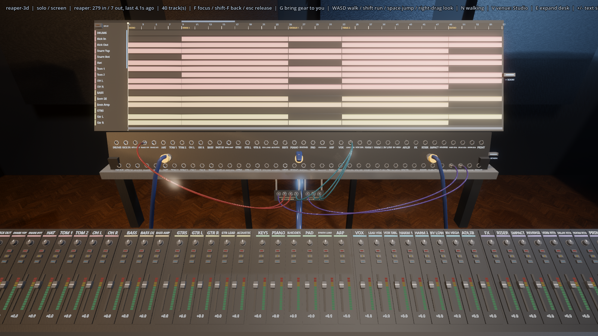

The whole song is laid out at once. The timeline fits the project until you zoom or scroll it.
Forty strips sit on the desk, all of them in Reaper's bank of 64. Their names come from Reaper,
coloured by folder.

`--shot-tick 400`

## 2. Find the chorus

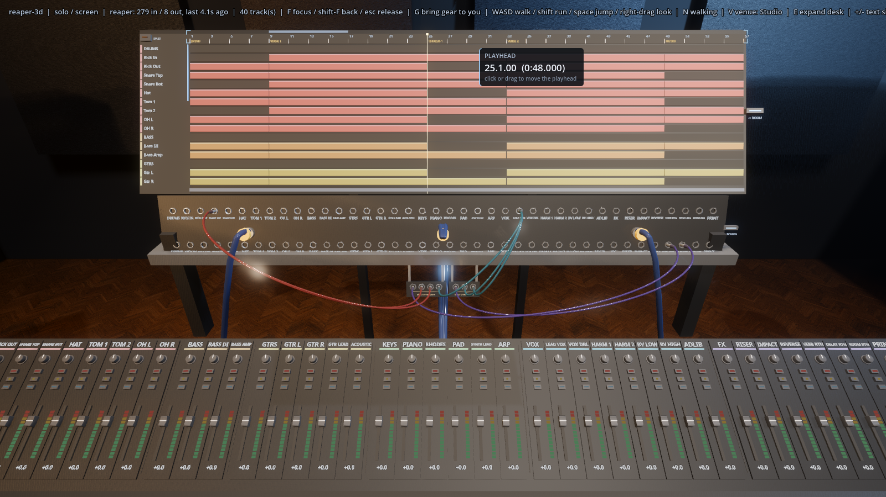

Click a bare stretch of lane under the CHORUS 1 marker. The session's leftover item selection
clears, and the playhead jumps to the click, snapped to the beat. Hovering the playhead reads it
back: **25.1.00 (0:48.000)**. Dragging along the number strip scrubs instead.

`--drag 773,88:773,88@120-124 --aim PLAYHEAD`

## 3. Loop it

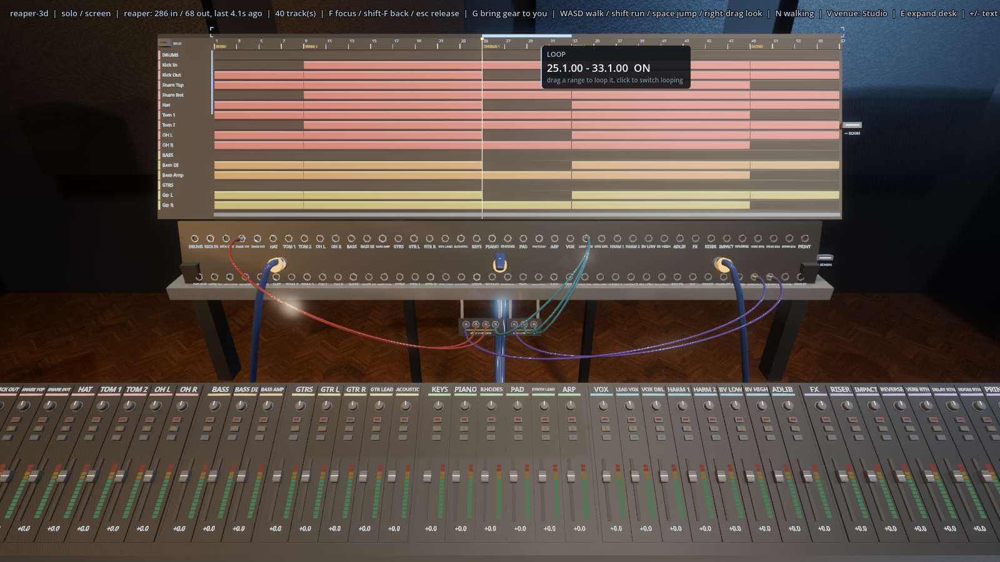

Drag along the loop band at the top of the ruler from bar 25 to bar 33. That sets Reaper's
time selection and turns looping on: **25.1.00 - 33.1.00 ON**. Clicking the band toggles the
loop.

`--drag 773,58:913,58@120-150 --aim LOOP`

## 4. Play

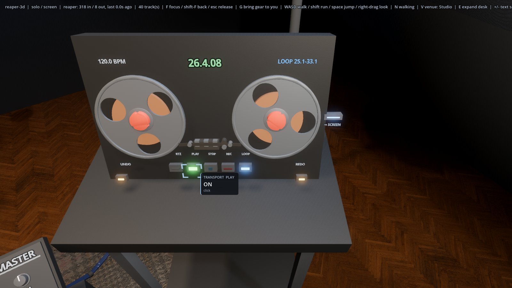

The tape deck is the transport: RTZ, PLAY, STOP, REC, LOOP, UNDO and REDO. **F** while looking
at it (or **G**) brings it to you; the picture is the focused deck. PLAY lights, and the counter
runs in bars and beats inside the loop shown on the right.

`--focus tape_deck --click TRANSPORT__PLAY@200 --aim TRANSPORT__PLAY`

## 5. Balance

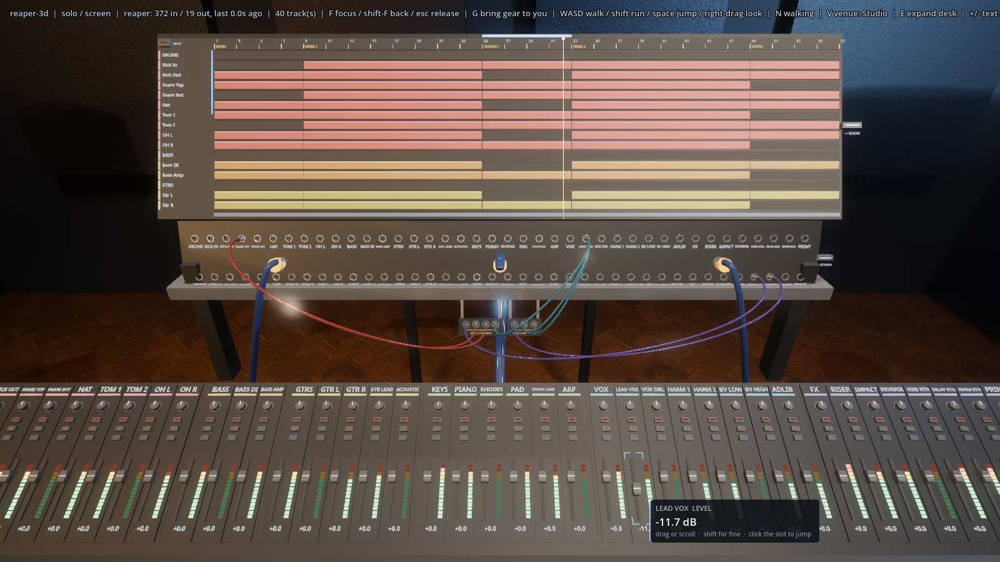

Pull the lead vocal's fader down. The card reads the level Reaper reports, **-11.7 dB**, and the
strip's scribble strip follows. Shift is fine control, the wheel nudges, and clicking the slot
jumps the cap there.

`--pull LEAD_VOX__LEVEL:0,8@120-160 --aim LEAD_VOX__LEVEL`

## 6. Pan

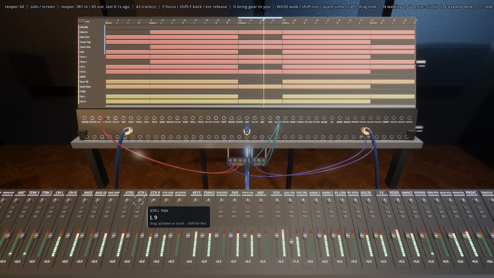

Spread the guitars: Gtr L down to the left, Gtr R up to the right. Knobs drag vertically, the
way every plugin UI works. The card reads **L 9**.

`--pull GTR_L__PAN:0,40@120-150 --pull GTR_R__PAN:0,-40@180-210 --aim GTR_L__PAN`

## 7. Solo

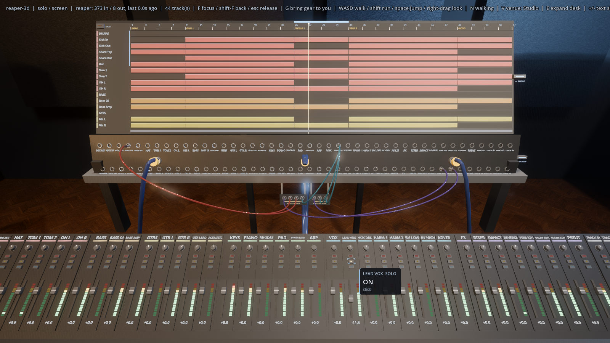

Solo the lead vocal to hear it alone. The button lights and Reaper solos the track.

`--click LEAD_VOX__SOLO@150 --aim LEAD_VOX__SOLO`

## 8. Mute

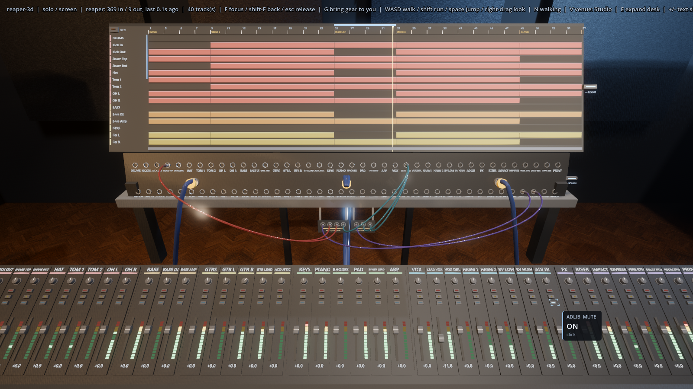

Unsolo it, and mute the adlib track, which fights the vocal in the chorus.

`--click LEAD_VOX__SOLO@150 --click ADLIB__MUTE@190 --aim ADLIB__MUTE`

## 9. Arm

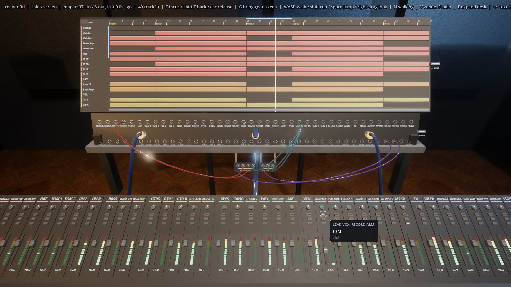

Arm the vocal for a punch-in. With the track armed, REC on the deck records into it.

`--click LEAD_VOX__RECORD_ARM@150 --aim LEAD_VOX__RECORD_ARM`

## 10. The rack

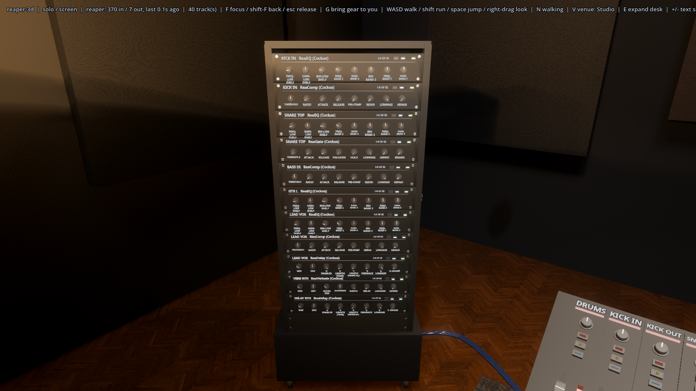

Bring the rack over (**F** on it). Every plugin on every track hangs in it, captioned with its
track: KICK IN ReaEQ + ReaComp, SNARE TOP ReaEQ + ReaGate, BASS DI ReaComp, GTR L ReaEQ, LEAD
VOX ReaEQ + ReaComp + ReaDelay, and the reverb and delay returns. Knobs carry the plugin's own
parameter names (THRESHOLD, RATIO, ATTACK…), eight to a page, paged with the arrows at the right.

`--focus rack`

## 11. A/B the compressor

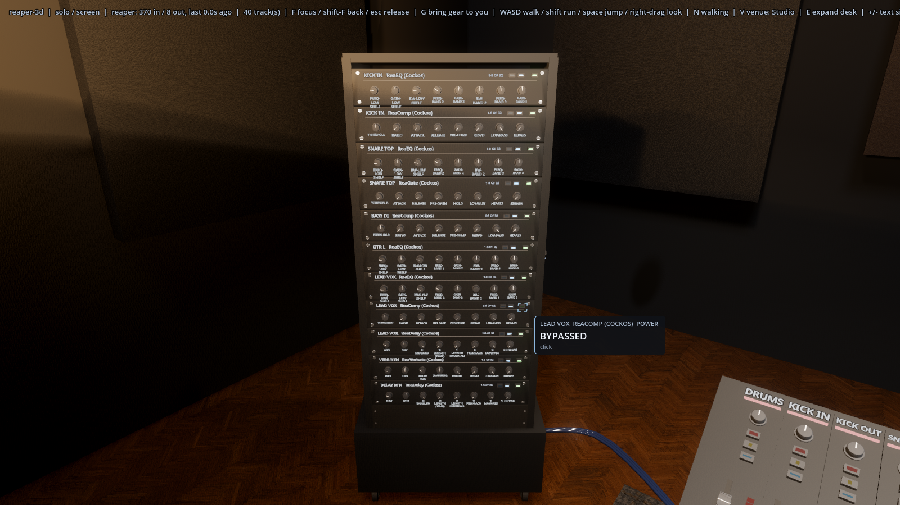

The POWER key bypasses the plugin in Reaper; its lamp goes dark and the card reads
**BYPASSED**.

`--focus rack --click LEAD_VOX__REACOMP+POWER@150 --aim LEAD_VOX__REACOMP+POWER`

## 12. Set the threshold

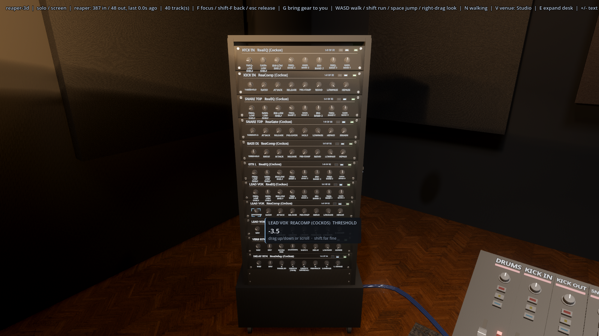

Back in, then pull the threshold down. The card shows the plugin's own reading, fetched from
Reaper for the knob under your hand. ReaComp prints its threshold as **-3.5** (dB). A plugin
Reaper cannot read falls back to a percentage.

`--focus rack --click LEAD_VOX__REACOMP+POWER@150 --pull LEAD_VOX__REACOMP+THRESHOLD:0,40@200-240 --aim LEAD_VOX__REACOMP+THRESHOLD`

## 13. Stop

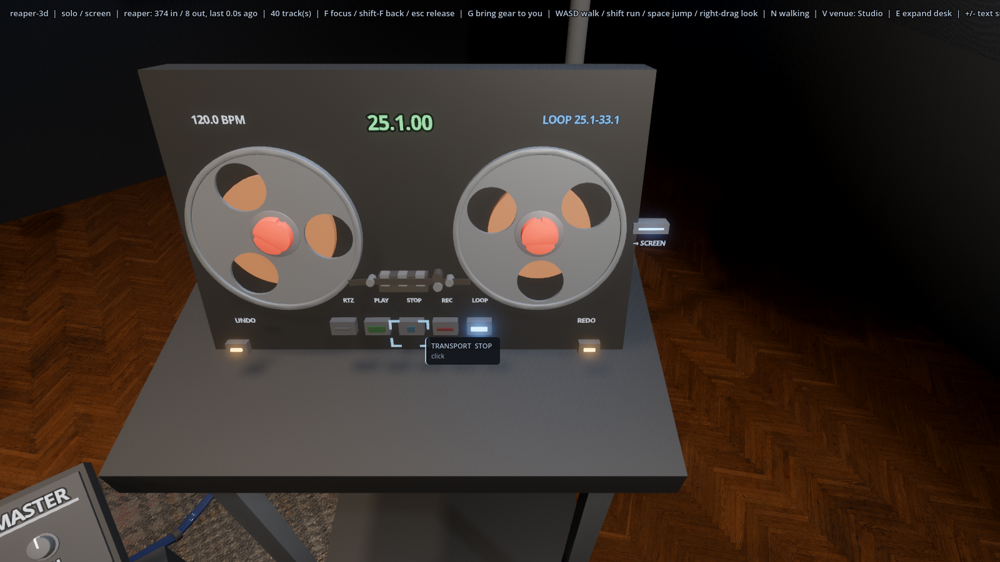

STOP. Reaper returns to where playback started, **25.1.00**, and the loop stays set.

`--focus tape_deck --click TRANSPORT__STOP@200 --aim TRANSPORT__STOP`

## 14. Split

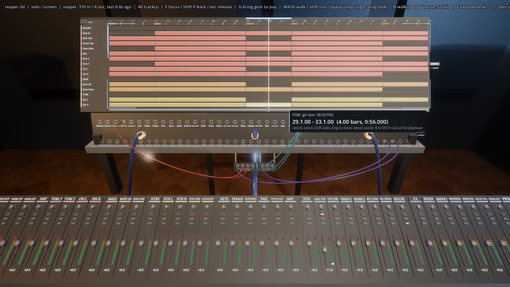

Gtr R plays the whole chorus. Click a bare spot of the DRUMS folder lane at bar 29 to put the
playhead there, click Gtr R's chorus item to select it, and press SPLIT (the key in the
timeline's top-left corner, or **B**). The back half now reads **29.1.00 - 33.1.00 (4.00
bars)**, and both halves stay selected, as they do in Reaper.

`--drag 845,88:845,88@200-204 --drag 845,328:845,328@240-244 --click EDIT__SPLIT_AT_PLAYHEAD@280 --hover 885,328`

## 15. Move

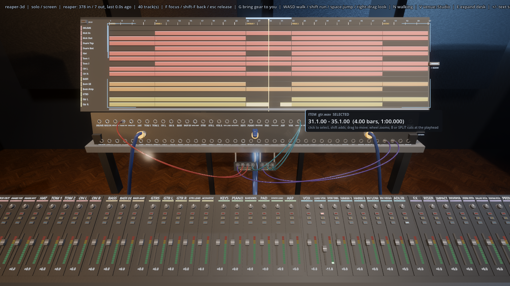

Drag the back half two bars late, for a stutter into the second verse. While it is held, the
block is drawn where it will land and the card reads **move to 31.1.00**. Starts snap to the
beat (hold Shift for free placement). Let go, and it is at **31.1.00 - 35.1.00**.

`--drag 880,328:916,328@220-260 --hover 935,328`

## 16. Undo

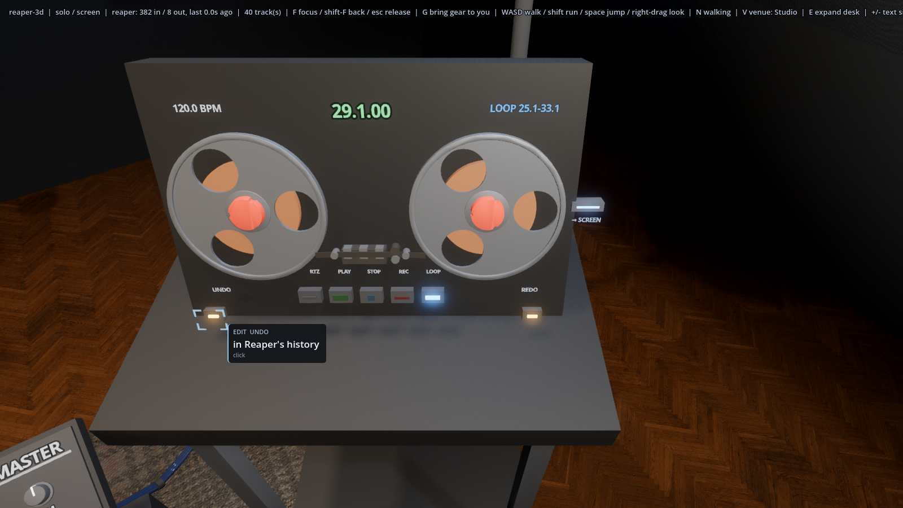

It doesn't work. UNDO on the deck takes it back, through Reaper's own history, so it is the same
undo Reaper's menu would give and REDO brings it back.

`--focus tape_deck --click EDIT__UNDO@200 --aim EDIT__UNDO`

## 17. Forty tracks

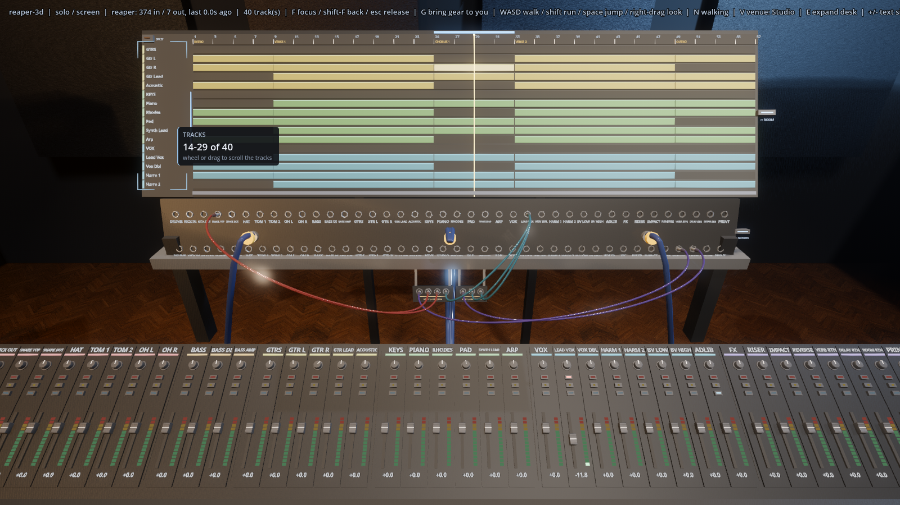

Sixteen lanes fit on the panel. Drag the track names up, or use the wheel over them, to bring
the vocals into view. The card reads **14-29 of 40**, and the slot beside the names shows where
you are in the list.

`--drag 300,320:300,100@120-170 --aim TRACKS`

---

## What this proves, and how

| Goal | Proven by |
| --- | --- |
| Transport and playhead from the desk, bar/beat shown | steps 2–4, 13; `tests/run_tests.gd` transport and ruler tests; `tools/probe/live_check.gd` |
| Fader, pan, mute, solo, arm in step with Reaper | steps 5–9; link and echo-guard tests; live check |
| Names on a 40-track project | steps 1, 17; live check "every track's name (40 of 40)" |
| Plugin chain, bypass, parameters | steps 10–12; fx wire tests (names, text, bridge naming) |
| Select, split, move, loop range | steps 2–3, 14–15; `_test_items_are_edited_on_the_timeline` |
| Undo | step 16; undo and redo tests |
| Clickable from the seat, exact hover values | seat audit (every control ≥ 7 px and hit by its own ray at 1600×900); every card above |

Known rough edge: right after a launch, the HUD's track count can briefly read a few more than 40,
while Reaper's bank slots arrive before the project size does. The desk itself never draws them.
